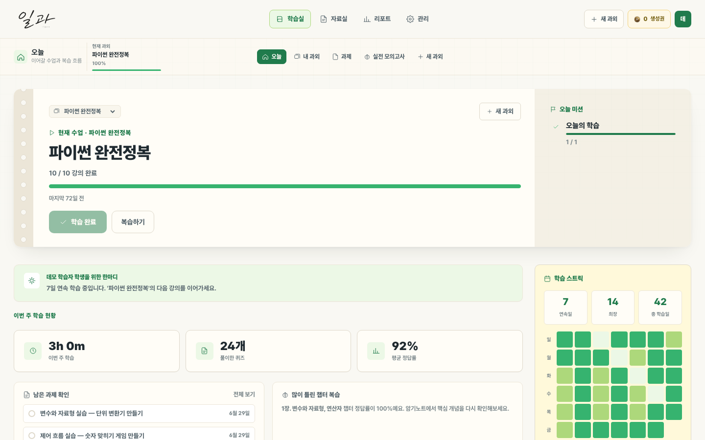
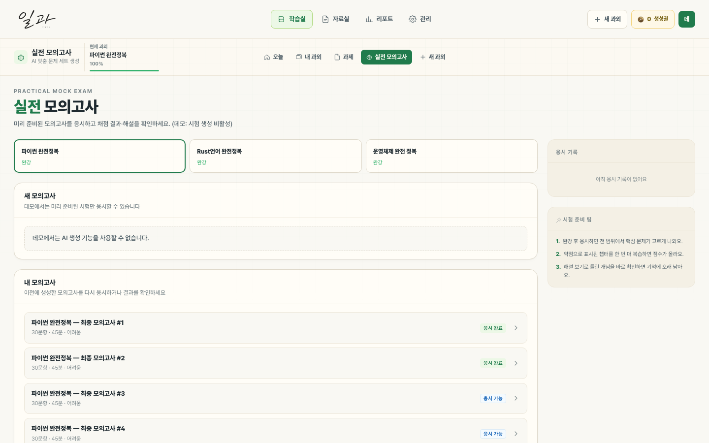
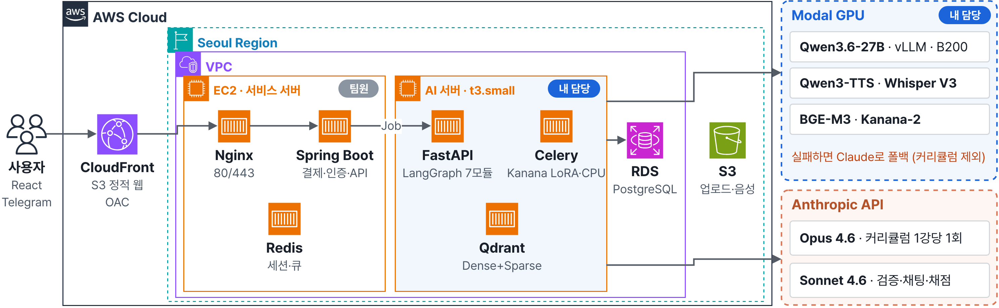

<h1 align="center">$\bf{\large{\color{#6580DD} 일과 · ilgwa }}$</h1>

**전공 PDF 교재나 학습 주제를 넣으면 커리큘럼, 강의 슬라이드, 음성 수업, 모의고사를 만들어 주는 AI 과외 플랫폼입니다.**

가이드, 학습, 복습을 한 곳에서 할 수 있도록 만들었습니다. 2026년 4월부터 6월까지 2인 팀으로 개발했습니다.

[](https://algocean1204.github.io/SW-ilgwa/)
[](https://huggingface.co/aisamdasu/algocean-2.1B-nano-friend)

| 학습실 | 실전 모의고사 |
|---|---|
|  |  |

데모는 로그인 없이 바로 열립니다. 파이썬, Rust, 운영체제 3과목의 슬라이드, 음성 수업, 모의고사, 암기노트, 과제가 들어 있습니다. 서버 없이 브라우저에서만 동작하는 정적 데모라서 새 강의와 시험을 만드는 기능은 꺼 두었습니다.

<hr>

## 개발 환경

### Language


### Framework & Runtime


### Database


### AI & Model


### Infra


<hr>

## 주요 기능

### 1. 강의 자동 생성
- 커리큘럼을 먼저 설계한 뒤 슬라이드, 퀴즈, 암기노트, 과제, 음성 대본을 만듭니다.
- AI는 미리 정의한 템플릿 75종 중 하나를 골라 JSON 빈칸만 채웁니다. 레이아웃과 강조 색이 요청마다 바뀌지 않습니다.
- 슬라이드는 vLLM 8슬롯으로 병렬 생성하고, 사실·논리 검증에서 지적된 필드만 다시 고칩니다.

### 2. 실전 모의고사
- LangGraph 6단계(자료 분석, 출제 계획, 문제 생성, 오답 구성, 정답 해설, 교차 검증)로 출제합니다.
- 정답 위치를 미리 무작위로 배정하고, 4개 에이전트가 병렬로 문제를 만듭니다.
- 교차 검증에 실패한 문항만 최대 3회 교정하고, 교정이 안 되면 그 문항만 다시 생성합니다.

### 3. 교재 OCR과 하이브리드 검색
- Marker로 전체 페이지를 추출하고, 품질 게이트에 걸린 페이지만 MinerU 재추출과 Kanana-2 후처리를 거칩니다.
- 쪽 번호 제거, 하이픈 복원, 문장 병합, 표·수식 표기 통일 순서로 정규화한 뒤 600~1,200 토큰으로 청킹합니다.
- BGE-M3 Dense와 Sparse 벡터를 Qdrant에 저장하고 RRF(k=60)로 결합해 검색합니다.

### 4. 음성 수업
- Qwen3-TTS 음성 클로닝으로 강의 대본을 읽어 줍니다.
- 참조 음성을 float32로 정규화하고, 문장 단위로 합성해 0.06초 무음을 넣어 이어 붙입니다.

### 5. 강의 Q&A와 과제 알림
- 강의 내용에 맞춘 질의응답을 SSE 스트리밍으로 제공합니다.
- 과제 알림 문구는 Kanana Nano 2.1B를 LoRA SFT로 학습하고 Q4로 양자화해 CPU에서 생성하며, Telegram으로 보냅니다.

<hr>

## 아키텍처



요청은 CloudFront와 Nginx를 거쳐 Spring Boot로 들어옵니다. Spring은 결제, 인증, 학습 데이터를 맡고, 강의·시험 생성처럼 오래 걸리는 작업은 FastAPI로 넘깁니다. FastAPI는 이를 비동기 Job으로 받아 기능별 LangGraph 파이프라인을 실행하고, 결과를 저장한 뒤 Spring에 콜백합니다.

| 모듈 | 역할 |
|---|---|
| Agent_orchestrator | 비동기 Job 접수, 멱등 키로 중복 실행 방지, 완료 콜백 |
| ChapterStudio_V1 | 커리큘럼, 슬라이드, 퀴즈, 노트, 과제, 음성 대본 생성 |
| ExamForge_V1 | 실전 모의고사 출제 |
| OCR_v1 | 교재 PDF 추출, 품질 게이트, 청킹, Qdrant 적재와 검색 |
| TTS_V2 | 음성 수업 합성 |
| Chat_V1 | 강의 맞춤 Q&A |
| AssignmentGrader_V1 | 과제 채점 |

| 작업 | 모델 |
|---|---|
| 커리큘럼 설계 | Claude Opus 4.6 |
| 슬라이드·퀴즈·노트·과제 생성 | Qwen3.6-27B FP8 (vLLM, Modal) |
| 음성 합성 / 음성 인식 | Qwen3-TTS / Whisper V3 Turbo (Modal) |
| 임베딩·재순위 | BGE-M3, reranker (Modal) |
| 검증, 채팅, 채점 | Claude Sonnet 4.6 |
| 알림 문구 | Kanana Nano 2.1B + LoRA (Q4, CPU) |

커리큘럼 외의 작업은 Modal 호출이 실패하면 Claude로 넘어갑니다.

<hr>

## 측정 결과

| 항목 | 결과 |
|---|---|
| 1강(10~15슬라이드) 생성 시간 | 512초 → 120초 |
| GPU 콜드 스타트 | 12.4초 → 0.8초 |
| 교재 검색 Top-3 적중률 (질의 240개) | 37.5% → 65.8%, MRR 0.300 → 0.632 |
| 저화질 스캔 페이지 OCR CER | 0.14 |
| 알림 모델 eval loss | 1.640 → 1.241 |
| 음성 클로닝 화자 유사도 (ECAPA-TDNN) | 0.847 |

측정 방법과 세부 수치는 [project/Docs/elseDocs](project/Docs/elseDocs)에, 측정 스크립트는 [project/benchmarks](project/benchmarks)에 있습니다.

<hr>

## 저장소 구성

```
project/
├── backend-fastapi/     AI 추론 서버 (FastAPI, LangGraph, Celery)
├── backend-spring/      서비스 API 서버 (Spring Boot)
├── frontend-web/        웹 클라이언트 (React, Vite)
├── portfolio-showcase/  정적 데모 (React, MSW)
├── infra/               로컬 실행용 Docker Compose, DB 스키마
├── lib-rust/            PDF·이미지 전처리 확장 모듈 (PyO3)
├── benchmarks/          OCR·검색·TTS 측정 스크립트
└── Docs/                설계 문서 (아키텍처, API, ERD, 실측)
```

<hr>

## 설치 및 실행

로컬 DB(PostgreSQL, Redis, Qdrant)를 띄운 뒤 필요한 서버를 실행합니다. 설정 항목 이름은 각 디렉터리의 `.env.example`에 있습니다.

```bash
# DB 스택 (--full을 붙이면 FastAPI, Frontend, Nginx까지 함께 기동)
cd project/infra
cp .env.example .env
./scripts/dev-up.sh

# FastAPI 서버와 Celery 워커 (Python 3.12, uv)
cd ../backend-fastapi
uv run uvicorn main:app --reload
uv run celery -A app.celery_app worker --loglevel=info --concurrency 2

# 정적 데모
cd ../portfolio-showcase
npm i && npm run build && npm run preview
```

<hr>

## 팀

| 이름 | 역할 |
|---|---|
| 김태규 | AI 아키텍처, FastAPI 추론 서버, LangGraph, Modal GPU, RAG 구축 |
| 김나경 | Spring Boot 서비스 서버, AWS 인프라 배포 |

<hr>

## 라이선스

[GNU AGPL-3.0](LICENSE). 교재 OCR에 쓰는 MinerU(AGPL-3.0)와 Marker(GPL-3.0)의 조건에 맞춰 AGPL-3.0으로 공개합니다. Rust 확장 모듈(`project/lib-rust`)은 Apache License 2.0입니다.
