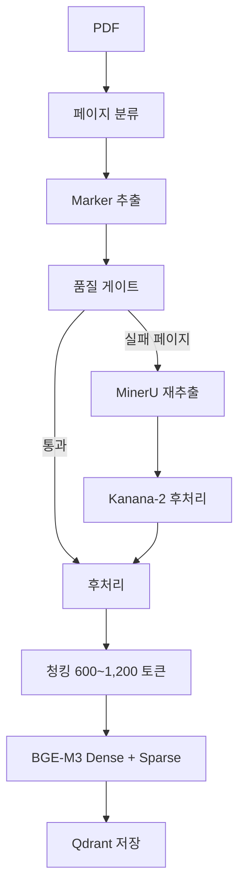
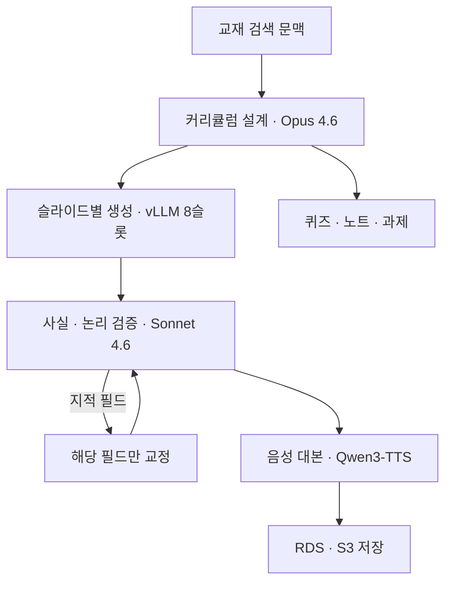
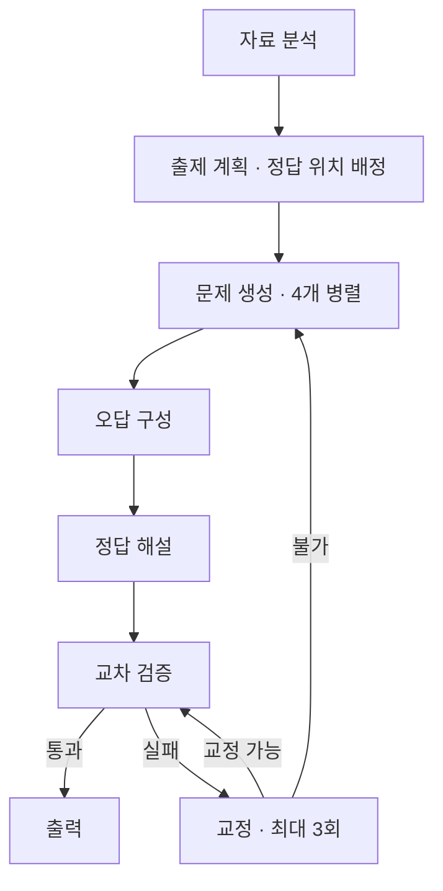

# 일과 · ilgwa

전공 PDF 교재나 학습 주제를 넣으면 커리큘럼부터 강의 · 음성 수업 · 모의고사까지 만들어 주는 AI 과외 플랫폼이다.

[](https://algocean1204.github.io/SW-ilgwa/)


<hr>

## 데모

https://algocean1204.github.io/SW-ilgwa/

로그인 없이 메인 화면에서 바로 시작한다. 파이썬, Rust, 운영체제 3과목의 슬라이드, 음성 수업, 모의고사, 암기노트, 과제가 들어 있다.

> 서버 없이 브라우저에서만 도는 정적 데모이다. 새 강의와 새 시험을 만드는 기능은 꺼 두었다.

| 학습실 | 실전 모의고사 |
|---|---|
|  |  |

<hr>

## 개요

| 항목 | 내용 |
|---|---|
| 기간 | 2026.04 ~ 2026.06 · 개발 11주 |
| 팀 | 2인 · 내 역할: LangGraph · RAG 구축 |

- 처음 AI를 독학할 때 무엇부터 배워야 할지조차 몰라, 여러 플랫폼을 헤매던 경험에서 출발했다.
- 자료를 찾느라 쓰는 공부 외적인 시간을 줄이고, 가이드 · 학습 · 복습을 한 곳에 묶어 스스로 찾아 공부하는 힘을 기르는 것이 이 서비스의 목표다.

<hr>

## 기술 스택

### AI · 모델 서빙


### 백엔드


### 데이터 · 검색


### 인프라 · 프론트엔드


<hr>

## 아키텍처


사용자 요청은 CloudFront와 Nginx를 거쳐 Spring Boot로 들어온다. Spring은 결제, 인증, 학습 데이터를 맡고, 강의·시험 생성처럼 오래 걸리는 작업은 사설 IP로 FastAPI에 넘긴다. FastAPI는 작업을 비동기 Job으로 받아 기능별 LangGraph 파이프라인을 돌리고, 결과를 RDS와 S3에 직접 저장한 뒤 Spring에 콜백한다.

| 구성 요소 | 역할 |
|---|---|
| Agent_orchestrator | Spring 요청을 비동기 Job으로 받고, 멱등 키로 중복 실행을 막고, 끝나면 Spring에 콜백 |
| ChapterStudio_V1 | 커리큘럼, 슬라이드, 퀴즈, 노트, 과제, 음성 대본 생성 |
| ExamForge_V1 | 실전 모의고사 출제 (LangGraph 6단계와 검증 루프) |
| OCR_v1 | 교재 PDF 추출, 품질 게이트, 청킹, Qdrant 적재와 검색 |
| TTS_V2 | 음성 수업 합성 (Qwen3-TTS 음성 클로닝) |
| Chat_V1 | 강의 맞춤 Q&A (스트리밍) |
| AssignmentGrader_V1 | 과제 채점과 Spring 콜백 |

| 작업 | 모델 | 실행 위치 |
|---|---|---|
| 커리큘럼 설계 (1강당 1회) | Claude Opus 4.6 | API |
| 슬라이드 · 퀴즈 · 노트 · 과제 생성 | Qwen3.6-27B FP8 (vLLM) | Modal B200 |
| 음성 수업 | Qwen3-TTS | Modal H100 |
| 음성 인식 | Whisper V3 Turbo | Modal GPU |
| 교재 임베딩 · 재순위 | BGE-M3 (Dense + Sparse) · reranker | Modal GPU |
| 교재 OCR 후처리 (게이트 실패 쪽만) | Kanana-2 | Modal B200 |
| 사실 · 논리 검증, 채팅, 채점 | Claude Sonnet 4.6 | API |
| 알림 문구 | Kanana Nano 2.1B + LoRA (Q4, llama.cpp) | CPU 워커 |

폴백은 Claude 하나로 통일했다. 커리큘럼 외의 작업은 모두 Modal이 실패하면 Claude로 넘어간다.

<hr>

## 문제 해결

### 1. [LLM 서빙] 강의 생성 시간 단축과 작업별 모델 라우팅 | 생성시간 512초 → 120초(-76.6%)

- 문제: 상용 API만 쓰기엔 비용 대비 성능이 과했다. 초기 1강 생성에 512초, 콜드 스타트에 12.4초가 걸려 GPU 점유 비용이 크게 나왔다. 요청마다 모델 가중치를 GPU에 다시 로드했고, 슬라이드를 한 장씩 순차적으로 처리해 장수가 늘수록 시간이 길어졌다.
- 해결: 커리큘럼만 상위 AI 1회(Claude Opus), 각 내용 생성은 자체 GPU(Qwen3-TTS, Qwen3.6-27B FP8), 단문은 CPU로 나누고 폴백(Modal → Claude)을 붙였다. 커리큘럼을 먼저 설계 하고, 각 슬라이드끼리 vLLM batching으로 8슬롯 병렬 생성했다. 가중치를 GPU 스토리지에 미리 로드했고, GPU 스냅샷을 통해 콜드스타트를 감소시켰다. B200을 선택한 이유는 느린 저사양 GPU보다 빨리 끝내고 반납하는 B200이 총과금이 낮아 전환했다.
- 결과: 1강(10~15슬라이드) 생성 512초 → 120초(준비 · 생성 · 검증 · 음성 포함), GPU 콜드 스타트 12.4초 → 0.8초, 1강당 총 과금 $0.38 으로 감소했다.

### 2. [파인튜닝] 알림 말투 LoRA SFT학습과 CPU 서빙 | eval loss −24.3%

- 모델: [aisamdasu/algocean-2.1B-nano-friend](https://huggingface.co/aisamdasu/algocean-2.1B-nano-friend)
- 문제: 과제 알림을 GPU · 유료 API로 만들어 비용이 들었고, 기본 모델은 30개 중 27개가 입력 프롬프트가 재출력후 답변하는 문제와 상투적인 말투였다
- 해결: Kanana Nano 2.1B를 친구 대화 약 22만 줄로 LoRA SFT학습했다(r=128 · alpha=256 · q/k/v/o + MLP, Modal H100). 200 step마다 평가하고, 검증 셋 기준 eval loss를 1.640 → 1.241(−24.3%)로 낮추며 구어체 분포를 안정적으로 학습했다. CPU서빙을 위해 Q4로 양자화 후, 모델을 워커당 1회 로드하고 워커 2~3개로 제한해 CPU로 서빙했다. 코드 검증에서 형식을 벗어나면 재시도후, Haiku로 폴백한다.
- 결과: 같은 알림 프롬프트에서 상투적인 표현이 20/30 → 1/30으로 줄고, '15분씩 10개씩'처럼 바로 따라 할 수 있는 행동 제안이 3/30 → 15/30으로 늘었다. 양자화 결과 4 vCPU 서버에서 22.3 tok/s로 실시간에 가까운 속도가 나왔다.
- 예시:
  - [개선 전 (원본 모델 + 요청 한 줄, 575토큰)]
    ```text
    ### [학생명: 민준] 과제 알림 — **마감:** 2023년 6월 29일
    이번 과제는 자바 프로그래밍에서 객체의 소유권과 복사의 개념을 이해하고, … (중략) … 담당 교수님께 문의하세요.
    **민준 학생** 6월 29일까지 꼭 완성 부탁드립니다! 좋은 성과 있기를 바랍니다. 😊
    ```
  - [개선 후 (LoRA + 친구 말투 프롬프트, 39토큰)]
    ```text
    민준아, 소유권 실습 6월 29일까지야. 오늘은 Move랑 Copy 예제 두 개만 메모장에 적어보고 비교해보자.
    ```

### 3. [Agent] 출력 형식 고정과 선별적 재시도 | 템플릿 75종 · LangGraph 6단계 파이프라인

- 문제: AI에게 HTML · CSS를 통째로 맡기니 태그가 빠지거나 요청마다 레이아웃과 강조 색이 달라졌다. 또한 결과가 나오더라도, 가독성과 품질이 너무 떨어지는 문제가 발생했고, 모의고사는 한 번에 출제해 문항 수가 틀리고 정답 번호가 편향되었으며, 정답인 보기가 오답에 섞였다.
- 해결: 파인튜닝 없이 75종 템플릿 JSON 형식을 사전에 만들어두고, AI는 적절한 템플릿을 가져와 빈칸만 채우게 했다. 모의고사는 LangGraph 6단계(자료 분석 → 출제 계획 → 문제 생성 → 오답 구성 → 정답 해설 → 교차 검증)로 나눠 정답 위치를 랜덤값으로 사전 배정하고 4개 에이전트가 병렬 출제한 뒤, 교차 검증에 실패한 문항만 최대 3회 수정하도록(수정 실패시 그 문항만 다시 생성) 하였다.
- 결과: 강조 색상과 레이아웃이 흔들리지 않고 일정하게 유지됐고, AI가 HTML 대신 칸 안의 내용에만 집중해 내용 품질도 좋아졌다.

### 4. [RAG] 교재 OCR과 하이브리드 검색 | Marker → MinerU 이중 파이프라인

- 문제: 초기 OCR 모델(PP-OCRv5)은 Kanana-2 후처리 후에도 글자 오류율(CER)이 0.492 → 0.408로 개선 폭이 미미했고, 전 페이지에 후처리를 일괄 적용하면 환각(원문에 없는 문장 생성)으로 인해 오히려 CER이 0.437로 악화되었다.
- 해결: 학습 PDF의 70~80%가 텍스트 기반인 점을 고려해, Marker로 전체 페이지를 먼저 빠르게 추출하고 품질 게이트에 걸린 스캔 이미지 페이지만 MinerU 재추출 및 Kanana-2 후처리를 거치도록 설계했다. 이후 600~1,200 토큰으로 청킹해 BGE-M3로 임베딩하고 Qdrant 하이브리드(Dense+Sparse) 검색을 사용했다.
- 결과: 교재 테스트셋 30개에서 저화질 스캔 페이지 기준 CER 0.14(Marker 텍스트 페이지 0.001, 스캔 이미지 페이지 0.009)을 달성했다. 실험 수치를 근거로 Kanana-2 후처리를 품질 게이트 탈락 페이지에만 한정하여 LLM 환각 문제를 줄였다.

### 5. [Qdrant] 하이브리드 교재 검색과 텍스트 정규화 | Top-3 적중률 37.5% → 65.8%

- 문제: 의미(Dense) 검색만으로는 전공 용어나 키워드 중심 질의에서 정답 문단을 자주 놓쳤으며(키워드형 질의 Top-1 적중률 12.5%), Dense와 Sparse 검색은 점수 스케일이 달라 단순 합산하여 사용할 수 없었다.
- 해결: 적재 전 텍스트 정규화(쪽 번호 제거 → 하이픈 복원 → 끊긴 문장 병합 → 표·수식 표기 통일)를 거친 뒤, BGE-M3로 Dense(코사인)와 Sparse(키워드 가중치) 벡터를 함께 추출해 저장하고 점수 대신 순위 기반으로 결합하는 RRF(k=60) 하이브리드 검색을 적용했다.
- 결과: 교재 36쪽·질의 240개 테스트셋에서 하이브리드 검색 및 리랭커 적용 후 Top-3 적중률이 37.5% → 65.8%(강의 생성용 Top-10 기준 50.8% → 70.8%), MRR이 0.300 → 0.632로 상승했다(키워드형 Top-1 12.5% → 64.2%). 노이즈가 섞인 텍스트에서는 정규화만으로도 Top-3 적중률이 28.3% → 32.5%로 개선되었다. ([측정 기록](project/Docs/elseDocs/Qdrant_검색_정규화_실측.md))

### 6. [TTS] 음성 깨짐 | 화자 유사도 0.847

- 문제: 클로닝용 참조 음성은 int16인데 Qwen3-TTS는 -1.0~1.0 범위의 float32로 읽어, 정규화 없이 넣으면 파형이 1.0에서 잘려(클리핑) 참조 음성이 망가졌다. 합성할 텍스트가 길어질수록 음성이 깨지고 부자연스러워졌다.
- 해결: 참조 음성을 -1.0~1.0 범위의 float32로 정규화해 넣고, GPU에서의 병렬작업과 품질 향상을 위해 텍스트를 문장 단위로 잘라 합성한 뒤 하나로 합칠 때 문장 사이에 0.06초 무음을 넣었다. 더 자연스럽게 들리도록 temperature를 0.8로 맞췄다.
- 결과: 클리핑 잡음과 긴 문장의 깨짐 현상이 사라졌으며, 원본 음성과의 화자 유사도 0.847을 달성해 실제 육성 수준의 음성으로 합성되었다. (ECAPA-TDNN 임베딩 코사인 유사도 기준 데모 240개 평균, 동일 인물 실제 녹음 간: 0.845~0.879, 타인: 0.26~0.28) ([측정 기록](project/Docs/elseDocs/TTS_화자유사도_실측.md))

<hr>

## 파이프라인 흐름

### 교재 OCR (PDF → Qdrant)



### 강의 생성 (ChapterStudio)



### 실전 모의고사 (ExamForge)



<hr>

## 측정 기록

| 문서 | 내용 |
|---|---|
| [RAG_파이프라인.md](project/Docs/elseDocs/RAG_파이프라인.md) | 교재 적재와 검색 흐름, 단계별 설정 |
| [OCR_CER_실측.md](project/Docs/elseDocs/OCR_CER_실측.md) | Marker, MinerU, 품질 게이트, Kanana 후처리의 CER |
| [Qdrant_검색_정규화_실측.md](project/Docs/elseDocs/Qdrant_검색_정규화_실측.md) | 정규화와 하이브리드 검색의 Top-k 적중률, MRR |

측정 스크립트는 [project/benchmarks](project/benchmarks)에 있다.

<hr>

## 저장소 구성

```
.
├── docs/                    README 이미지 (아키텍처, 데모 화면)
└── project/
    ├── backend-fastapi/     AI 추론 서버 (FastAPI, LangGraph)
    ├── backend-spring/      서비스 API 서버 (Spring Boot)
    ├── frontend-web/        웹 클라이언트 (React, Vite)
    ├── portfolio-showcase/  정적 데모 (React, MSW)
    ├── infra/               로컬 실행용 Docker Compose, DB 스키마
    ├── lib-rust/            Rust 확장 모듈 (PyO3)
    ├── benchmarks/          OCR · 검색 측정 스크립트
    └── Docs/                설계 문서 (아키텍처, API, ERD, 실측)
```

`project/` 아래 코드는 팀 조직 SW-EZ-Team의 원본 저장소들을 포트폴리오용으로 옮긴 사본이다. 원본의 커밋 이력은 조직 저장소에 남아 있다. 환경 변수 파일, 내부 운영 문서, 실행 로그는 올리지 않았고, 각 서비스의 `.env.example`에 필요한 설정 이름이 있다.

<hr>

## 팀

| 이름 | 역할 |
|---|---|
| 김태규 | AI 아키텍처, FastAPI 추론 서버, LangGraph, Modal GPU, RAG 구축 |
| 김나경 | Spring Boot 서비스 서버, AWS 인프라 배포 |
