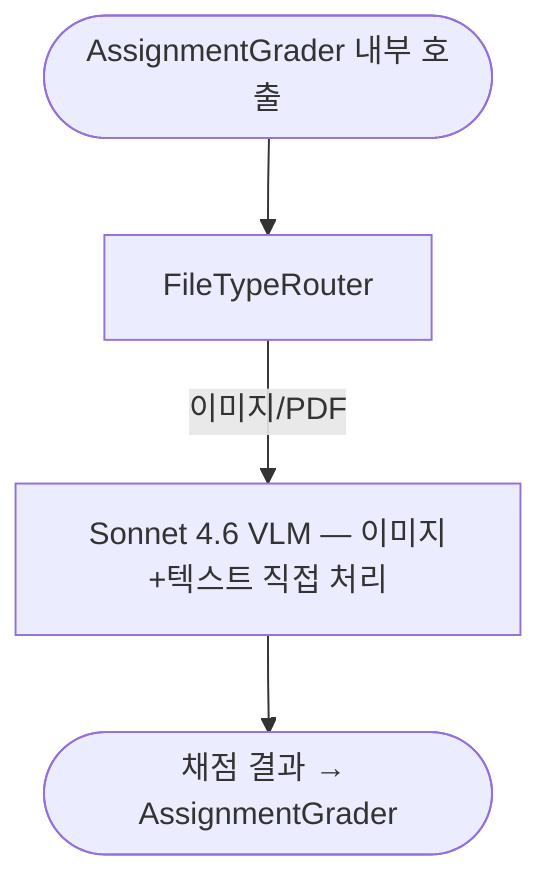
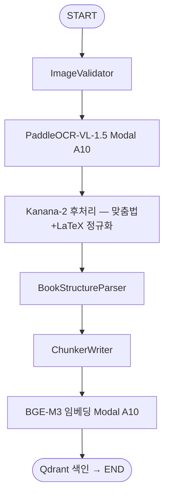
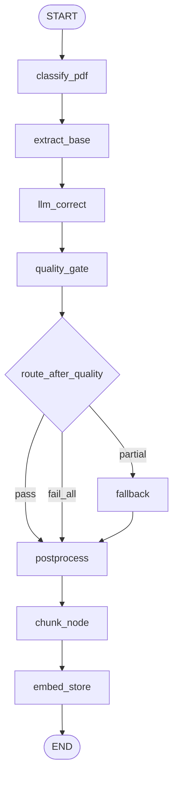
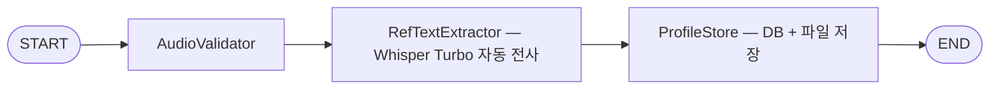
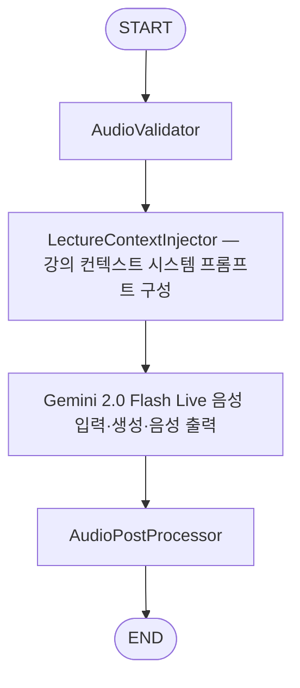
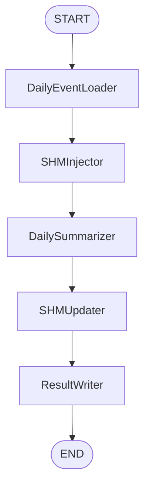
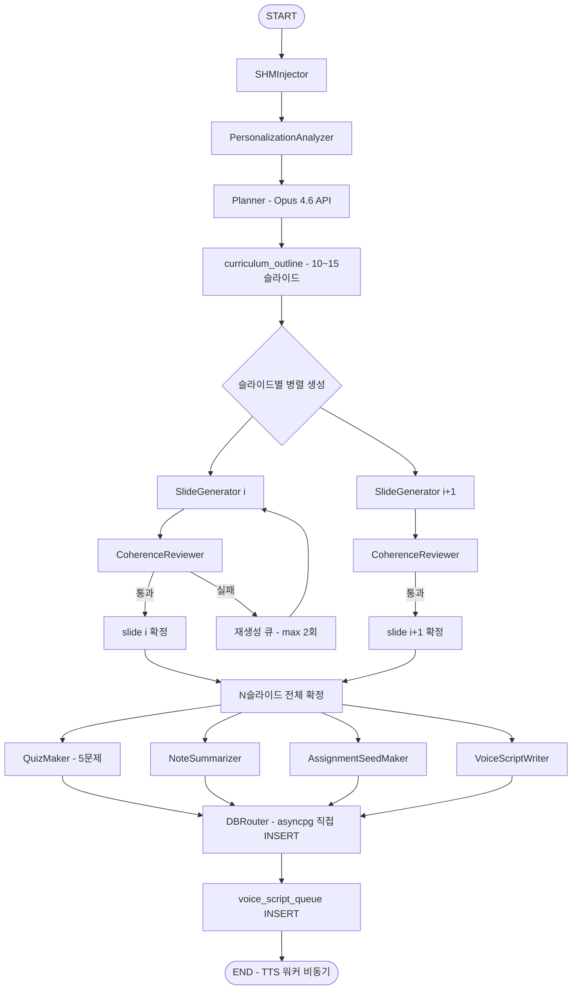
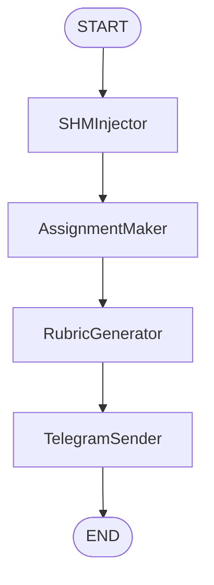
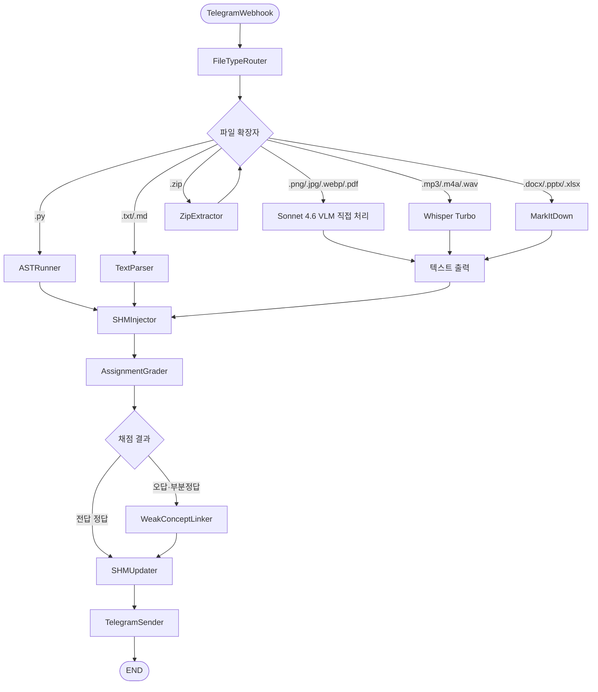

# FastAPI AI 파이프라인과 에이전트 설계 v3

> 상태: 설계 확정 (코드 구현은 별도 진행)
> 버전: v3.0
> 최종 업데이트: 2026-04-27

---

## 요약

OCR 경로는 두 갈래다.

- ①a 과제 채점: Sonnet 4.6 VLM이 이미지와 텍스트를 직접 읽는다. OCR 레이어를 두지 않는다.
- ①b(교재)·①c(범용 PDF): OCR_V1 하나로 처리한다. Marker로 1차 추출 → 품질 게이트 → 게이트에 걸린 페이지만 MinerU로 다시 뽑아 Kanana-2로 교정 → BGE-M3 Dense+Sparse 임베딩 → Qdrant `ocr_v1_chunks`. PaddleOCR-VL-1.5 Modal A10 경로는 2026-05-21에 폐기했다. 상세는 D-3 ①c.

### 파이프라인 전체 지도

| # | 이름 | 트리거 | 핵심 에이전트 | SSE | SHM 주입 |
|---|---|---|---|---|---|
| ①a | 과제 파일 OCR (⑥ 전처리) | ⑥ AssignmentGrader 내부 호출 (이미지·PDF 분기 시) | (없음, Sonnet 4.6 VLM 직접 처리, OCR 레이어 없음) | 아니오 | 아니오 (⑥ 내부 호출 시 ⑥ SHM 전파, 각주 참조) |
| ~~①b~~ | ~~참고도서 OCR~~ 폐기, OCR_V1로 대체 | ~~관리자 업로드~~ | ~~BookStructureParser~~ | 아니오 | 아니오 |
| ①c | OCR_v1 모듈식 OCR (①b 역할 흡수) | 관리자 또는 외부 시스템 PDF 업로드 (교재 포함 모든 PDF) | (없음, Marker/MinerU + Kanana-2 교정 + BGE-M3 임베딩 + Qdrant 저장) | 아니오 | 아니오 |
| ②a | Voice Profile | 음성 등록 | (없음, Qwen3-TTS ICL 모드로 ref_audio + ref_text 등록) | 아니오 | 아니오 |
| ②b | 음성 Q&A | 음성 질문 | (없음, Gemini 2.0 Flash Live가 음성 질문을 받아 음성으로 답함. ASR_V1을 거치지 않는 별도 경로) | 아니오 | 예 |
| ~~②c~~ | ~~질답+퀴즈 소크라테스 스트리밍~~ 폐기 | ~~텍스트 질문 or 슬라이드 퀴즈 응답~~ | ~~PersonalizationAnalyzer, QAResponder, WeakConceptLinker(오답 시)~~ | ~~예 (유일 예외)~~ | ~~예~~ |
| ③ | Daily Consolidation | Celery Beat 자정 | DailySummarizer | 아니오 | 예 |
| ④ | 챕터 생성 (롤포워드 병렬) | 관리자 or N 챕터 완료 시 N+2 트리거 | Planner + 7개 Executor | 아니오 | 예 |
| ⑤ | 과제 생성 | 커리큘럼 완료 or 관리자 수동 | AssignmentMaker | 아니오 | 예 |
| ⑥ | 과제 채점 | Telegram 웹훅 (파일 수신) | AssignmentGrader, WeakConceptLinker(오답 시) | 아니오 | 예 |

> ①a 각주: ①a는 독립 트리거가 없다. ⑥이 이미지·PDF를 수신했을 때 내부 호출하는 전처리 경로다. SHM 주입은 ⑥ AssignmentGrader에서 한다.
>
> 스트리밍 범위: 이 표의 SSE 열은 AI 파이프라인(FastAPI) 범위다. Spring Boot는 강의·알림 SseEmitter를 구현하지 않고 REST 상태 조회 또는 다음 요청 piggyback을 사용한다. Chat_V1 텍스트 채팅은 예외로 `POST /api/chat/v1/ask/stream`에서 SSE로 답변을 흘려보낸다(Claude Sonnet). `POST /api/chat/v1/ask`는 JSON으로 한 번에 응답한다.

### OCR_v1 컴포넌트 (①c 전용)

①c OCR_v1은 에이전트 체인 없이 Protocol 구현체로 구성한다.

| 컴포넌트 | 인터페이스 | 역할 |
|---|---|---|
| MarkerEngine | `OCREngine` Protocol | Marker(marker-pdf) 기반 1차 추출. `extract(pdf_bytes, pages, force_ocr, use_llm) → list[PageExtraction]` |
| MinerUEngine | `OCREngine` Protocol | MinerU(magic-pdf) 기반 폴백 재추출. 품질 게이트에 걸린 페이지만 처리하고, 결과는 Kanana-2로 교정 |
| SectionChunker | `Chunker` Protocol | heading 기반 섹션 청킹. 600~1200 토큰 범위, tiktoken 사용 |
| BgeM3Embedder | `Embedder` Protocol | BGE-M3 dense(1024d)+sparse 동시 생성. 배치 32. 기본은 Modal GPU 앱 `ocr-bge-m3`(`OCR_V1_EMBED_BACKEND=modal`), `local`이면 프로세스 안에서 돌린다(MPS 자동 감지) |
| QdrantStore | `VectorStore` Protocol | `ocr_v1_chunks` 컬렉션 upsert + Named vector 검색 |
| BgeReranker | `Reranker` Protocol | BGE-Reranker-v2-m3 크로스인코더. 임베딩과 같은 Modal 앱에서 돈다. `local`일 때 Apple Silicon은 `use_fp16=False` |

### 에이전트 × 파이프라인 매트릭스

| 파이프라인 | 참여 에이전트 |
|---|---|
| ①a | (에이전트 없음) |
| ~~①b~~ | ~~BookStructureParser~~ (폐기) |
| ①c | (에이전트 없음. Protocol 구현체 직접 호출: MarkerEngine, MinerUEngine, SectionChunker, BgeM3Embedder, QdrantStore, BgeReranker) |
| ②a | (에이전트 없음) |
| ②b | QAResponder, VoiceScriptWriter |
| ~~②c~~ | ~~PersonalizationAnalyzer, QAResponder, WeakConceptLinker(오답 시)~~ (폐기) |
| ③ | DailySummarizer |
| ④ | Planner, PersonalizationAnalyzer, SlideGenerator, CoherenceReviewer, QuizMaker, NoteSummarizer, AssignmentSeedMaker, VoiceScriptWriter |
| ⑤ | PersonalizationAnalyzer, AssignmentMaker |
| ⑥ | AssignmentGrader, WeakConceptLinker(오답 시) |

### 공통 규칙

- LangGraph: `StateGraph` + `PostgresSaver` Checkpointer를 전면 적용한다. ②a(Voice Profile) Linear만 예외.
- Checkpointer 네임스페이스 규칙: `{pipeline_id}:{user_id}:{session_id}`
- SSE: AI 파이프라인(FastAPI) 범위 내 전역 금지. Spring Boot도 강의·알림 SseEmitter를 구현하지 않는다. ②c 질답+퀴즈 스트리밍은 2026-04-27에 폐기했다. Chat_V1 텍스트 채팅은 예외로 `POST /api/chat/v1/ask/stream`에서 SSE로 답변을 흘려보낸다(Claude Sonnet). `POST /api/chat/v1/ask`는 JSON으로 한 번에 응답한다.
- 도메인 경계: AI 파이프라인·에이전트·SHM·Telegram 봇 라우터는 모두 FastAPI에 있다. Spring은 DB 쓰기와 콜백 수신만 한다. lib-rust PyO3는 PDF 래스터화(rasterize_pdf) 보조이며 별도 서버가 없다. ①a 과제는 Sonnet VLM이 직접 처리하고, 모든 PDF OCR은 OCR_V1을 거친다.
- Qdrant는 RAG(의미 검색) 전용이며 SHM(구조화 사실·상태)과 분리된다.
- WeakConceptLinker는 오답·부분이해일 때만 호출한다.

에이전트별 모델은 D-8, 모델 라우팅은 D-9, SHM 주입과 L3 카테고리는 D-10·D-11에 정리했다.

---

## Dual-path 아키텍처 개요 (2026-04-19 확정, 2026-05-21 갱신)

교재 OCR 경로(Path A)와 과제 채점 경로(Path B)는 완전히 분리된 파이프라인이다.

2026-05-21: Path A의 ①b(PaddleOCR-VL-1.5 Modal A10) 경로가 OCR_V1(①c)로 대체됐다. 아래 표는 이전/이후 비교다.

| 구분 | ~~Path A: 교재 OCR (①b) — DEPRECATED~~ | Path A: 교재 OCR (OCR_V1, ①c) — 현재 | Path B: 과제 채점 (①a/⑥) |
|---|---|---|---|
| 트리거 | ~~관리자 PDF 업로드~~ | 관리자 PDF 업로드 | 학생 Telegram 파일 제출 |
| OCR 모델 | ~~PaddleOCR-VL-1.5 Modal A10~~ | Marker + MinerU 이중 엔진 | 없음 (Sonnet 4.6 직접 처리) |
| 후처리 | ~~Kanana-2 2.1B MLX 4bit (전 페이지)~~ | 4-메트릭 품질 게이트 → 걸린 페이지만 MinerU 재추출 + Kanana-2 교정 | — |
| 임베딩 | ~~BGE-M3 dense만~~ | BGE-M3 dense(1024d) + sparse | — |
| 검색 | ~~cosine 유사도~~ | Dense+Sparse → RRF(k=60) → BGE-Reranker | — |
| 최종 저장 | ~~Qdrant `book_chunks`~~ | Qdrant `ocr_v1_chunks` | Spring DB (채점 결과) |
| 구현 위치 | ~~샌드박스 → 마이그레이션~~ | `Test_FastAPI_Module/OCR_v1/` → `backend-fastapi/app/modules/OCR_v1/` | backend-fastapi 직접 구현 |

---

## D-1. 제품 철학

설계 결정은 아래 세 문장을 기준으로 한다.

- **학부모/교사 직접 영향 = 0** — 학생용 AI 튜터 경험에 학부모/교사 페르소나가 노출되지 않는다.
- **학생이 감시받는 느낌 금지** — AI는 학생을 깊이 알되, 학생이 "관찰당하는 느낌"을 받게 해서는 안 된다.
- **1:1 최고의 과외선생, 단 둘이 공부하는 느낌** — 모든 응답·맞춤화는 이 맥락 위에 설계한다.

이 철학은 SHM L3 카테고리 선정(D-11절)에서 직접 기준으로 작동한다. `emotion`과 `parent_teacher_notes`가 제외된 이유도 이 세 문장에 근거한다.

---

## D-2. 9개 파이프라인 요약 표

| # | 파이프라인 | 트리거 | 모델 경로 | SSE | LangGraph | SHM 주입 |
|---|---|---|---|---|---|---|
| ①a | 과제 파일 채점 (⑥ 내부 경로) | ⑥ AssignmentGrader 내부 (이미지·PDF 분기 시) | **Sonnet 4.6 VLM 직접 처리** (이미지+텍스트 맥락 이해, OCR 레이어 없음) | 아니오 | StateGraph | 아니오 (⑥ SHM이 전파됨, 각주 ¹ 참조) |
| ~~①b~~ | ~~참고도서 OCR~~ **DEPRECATED — OCR_V1로 대체** | ~~관리자 업로드~~ | ~~PaddleOCR-VL-1.5 Modal A10 → Kanana-2 후처리 → BookStructureParser(Sonnet) → BGE-M3 임베딩~~ | 아니오 | ~~StateGraph~~ | 아니오 |
| ①c | OCR_v1 모듈식 OCR **(①b 역할 흡수)** | 관리자 또는 외부 시스템 PDF 업로드 (교재 포함 모든 PDF) | **Marker** 1차 추출 → 품질 게이트 → **MinerU** 폴백 → BGE-M3 Dense+Sparse 임베딩 → Qdrant RRF + BGE-Reranker | 아니오 | StateGraph (8-Stage) | 아니오 |
| ②a | Voice Profile | 음성 등록 | Qwen3-TTS ICL 모드 (ref_audio + ref_text → 음성 클로닝). DB+파일 기반 CRUD. | 아니오 | Linear | 아니오 |
| ②b | 음성 Q&A | 음성 질문 | Gemini 2.0 Flash Live (음성 입력과 음성 응답을 한 모델이 처리, ASR_V1과 별도). 강의 컨텍스트 시스템 프롬프트 주입. | 아니오 | StateGraph | 예 |
| ~~②c~~ | ~~질답+퀴즈 소크라테스 스트리밍~~ **DEPRECATED** | ~~텍스트 질문 or 슬라이드 퀴즈 응답~~ | ~~QAResponder(Sonnet) 토큰 스트림 + WeakConceptLinker(Haiku)~~ | ~~예~~ | ~~StateGraph~~ | ~~예~~ |
| ③ | Daily Consolidation | Celery Beat 자정 | DailySummarizer(Sonnet) | 아니오 | StateGraph | 예 |
| ④ | 챕터 생성 (롤포워드 병렬) | 관리자 or N 챕터 완료 시 N+2 트리거 | Planner(Opus, 1강당 1회) → Executor 그룹 병렬 | 아니오 | StateGraph + Checkpointer | 예 |
| ⑤ | 과제 생성 | 커리큘럼 완료 or 관리자 수동 | AssignmentMaker(Sonnet) → Telegram 발송 | 아니오 | StateGraph | 예 |
| ⑥ | 과제 채점 | Telegram 웹훅 (파일 수신) | AssignmentGrader(Sonnet) + WeakConceptLinker(Haiku, 오답 시) → Telegram DM 회신 | 아니오 | StateGraph | 예 |

스트리밍 정책: SSE 전역 미사용 (2026-04-17 확정). Chat_V1 텍스트 채팅은 예외로 `POST /api/chat/v1/ask/stream`에서 SSE로 답변을 흘려보낸다(Claude Sonnet). `POST /api/chat/v1/ask`는 JSON으로 한 번에 응답한다. ②c 토큰 스트리밍은 FastAPI `StreamingResponse`(HTTP chunked transfer)로 처리했다(②c는 폐기). ③ 일일 요약 완료 통지는 다음 요청 piggyback으로 처리한다. ⑥ 채점 완료 회신은 Telegram DM으로 처리한다. Spring Boot 영역의 강의·알림도 SseEmitter 없이 REST 상태 조회 또는 piggyback을 사용한다.

¹ ①a는 독립 트리거가 없다. ⑥ 파이프라인이 이미지·PDF 파일을 감지했을 때 내부적으로 호출된다. SHM 주입은 ①a가 아니라 ⑥ AssignmentGrader에서 한다.

---

## D-3. 파이프라인별 상세

### ①a 과제 파일 채점 — ⑥ AssignmentGrader의 이미지·PDF 직접 처리

> 독립 엔드포인트가 아니다. ⑥ AssignmentGrader가 이미지(.png/.jpg/.jpeg/.webp)나 PDF(.pdf)를 받았을 때 내부에서 타는 경로다. 관리자 참고자료 OCR은 ①c OCR_V1에서 한다.

2026-04-19에 ONNX Runtime(CPU) PaddleOCR 경로를 폐기하고 Sonnet 4.6 VLM이 이미지와 텍스트를 직접 처리하게 바꿨다. VLM이 이미지 맥락과 텍스트를 함께 읽으므로 별도 텍스트 추출 단계가 없다. 샌드박스 단계 없이 backend-fastapi에 바로 구현했다.



에이전트 체인: 없음 (Sonnet 4.6 VLM 직접 호출만 사용)

| 항목 | 내용 |
|---|---|
| 입력 | `image_or_pdf: bytes`, `user_id: str`, `assignment_id: str`, `rubric: Rubric` |
| 출력 | `score: float`, `feedback: str`, `plain_text: str`, `page_count: int` |
| 이점 | OCR 오류 누적 없음. 이미지 맥락(필기체·도표·수식)을 텍스트로 변환하지 않고 직접 이해 |

> 구현 위치: backend-fastapi 직접 구현. 샌드박스(Test_FastAPI_Module) 단계 스킵.

---

### ~~①b 참고도서 OCR (교재 Ingestion Pipeline)~~ — DEPRECATED

> 2026-05-21에 ①b 파이프라인을 OCR_V1(①c)로 대체했다. PaddleOCR-VL-1.5 Modal A10 경로는 쓰지 않고, 교재를 포함한 모든 PDF는 ①c로 처리한다. 아래는 이력으로 남긴 내용이다.

관리자가 참고도서 PDF/이미지를 올리면 PaddleOCR-VL-1.5 Modal A10이 텍스트를 추출하고, Kanana-2 2.1B MLX 4bit가 한국어 맞춤법과 LaTeX 수식을 정규화했다. 이후 BookStructureParser(Sonnet)가 목차·챕터 구조를 파싱하고 BGE-M3가 임베딩을 생성해 Qdrant에 색인한다.

2026-04-19 변경: CPU PP-OCRv5 ONNX 경로를 폐기하고 PaddleOCR-VL-1.5 Modal A10으로 전환했다. STEM 교재의 수식·표를 보존하려면 VLM이 필요했고, OmniDocBench 94.5%였다.



#### 에이전트 체인

1. **BookStructureParser** (Sonnet) — Kanana-2 정규화된 텍스트에서 목차·챕터 경계·섹션 레벨을 파싱한다.

| 항목 | 내용 |
|---|---|
| 입력 | `pdf_or_image: bytes`, `admin_id: str`, `book_metadata: dict` |
| OCR 모델 | PaddleOCR-VL-1.5 (0.9B VLM, Apache 2.0, Modal A10 24GB) |
| OCR 산출물 | `ocr_json: list[{page, bbox, text, conf}]`, `plain_text: str` |
| 후처리 | Kanana-2 2.1B MLX 4bit — 맞춤법 교정 + LaTeX 수식 정규화 (CER 16→0.22, 98.6% 감소 검증됨) |
| 최종 출력 | `structure: BookStructure`, `chapter_list: list[Chapter]`, `qdrant_collection_id: str` |
| 처리 속도 | ~2.5초/페이지. 500p 책 ≈ 1,250초. 콜드스타트 ~40초 (컨테이너 15s + 모델 로드 ~25s, Modal Volume 기준) |
| 비용 | ~₩763/책 (500p 기준) |
| 로컬 개발 | `paddleocr_vl_mlx_connector.py` (Mac MLX variant) |

> overlay PDF 산출물은 없다. OCR 결과는 Qdrant 색인에만 사용된다.

---

### ①c OCR_v1 — LangGraph 기반 모듈식 OCR 파이프라인

관리자나 외부 시스템이 PDF를 올리면 LangGraph 8-Stage StateGraph가 문서를 분류하고 Marker로 1차 추출한다. 품질 게이트를 통과하지 못한 페이지만 MinerU로 다시 추출하고 Kanana-2로 교정한다. 후처리를 마친 텍스트는 BGE-M3로 Dense+Sparse 임베딩 후 Qdrant `ocr_v1_chunks` 컬렉션에 저장된다. 2026-05-21부터 ①b(PaddleOCR-VL-1.5 Modal) 파이프라인을 대체해 교재를 포함한 모든 PDF가 이 경로를 쓴다.

2026-04-23에 `Test_FastAPI_Module/OCR_v1/` 샌드박스 구현을 마쳤다. 8-Stage LangGraph와 Protocol 기반 5-인터페이스로 설계했고, BGE-M3 Dense+Sparse 하이브리드 임베딩, Qdrant RRF 검색, BGE-Reranker-v2-m3 재정렬을 거친다.



#### 8-Stage 상세

| Stage | 노드 | 역할 |
|---|---|---|
| 1 | `classify_pdf` | PDF 페이지별 유형 분류 — born-digital / scanned / mixed, has_text_layer, image_ratio, confidence |
| 2 | `extract_base` | Marker(marker-pdf) 기본 추출 → 페이지별 markdown, tables, formulas |
| 3 | `llm_correct` | 선택적 LLM 교정 (표·수식 문제 페이지만, `OCR_V1_MARKER_USE_LLM_MODEL` 환경변수로 모델 지정) |
| 4 | `quality_gate` | 4-메트릭 품질 평가 + 조건부 라우팅 |
| 5 | `fallback` | MinerU(magic-pdf) 폴백 재추출 후 Kanana-2 교정 (게이트에 걸린 페이지만, 최대 1회 재시도) |
| 6 | `postprocess` | header/footer 제거, 하이픈 복원, 단락 병합, 표·수식 변환 |
| 7 | `chunk_node` | 섹션 기반 청킹 (heading 기반, 600~1200 토큰, tiktoken 사용) |
| 8 | `embed_store` | BGE-M3 dense(1024d)+sparse 임베딩 → Qdrant 저장 |

#### 품질 게이트 (Stage 4) 상세

4가지 메트릭을 가중합으로 평가하며, 개별 임계값을 모두 통과해야 "pass"로 라우팅된다.

| 메트릭 | 가중치 | 임계값 |
|---|---|---|
| char_corruption | 30% | ≤ 0.05 |
| reading_order | 25% | ≥ 0.85 |
| table_integrity | 25% | ≥ 0.80 |
| formula_preservation | 20% | ≥ 0.90 |
| **overall** | — | ≥ 0.70 |

라우팅 결과: "pass"(전 페이지 통과 → postprocess), "partial"(일부 실패 → fallback → postprocess), "fail_all"(전 실패 → postprocess 직행)

에이전트 체인은 없다. LLM은 Stage 3과 Stage 5 교정에서만 직접 호출한다.

| 항목 | 내용 |
|---|---|
| 입력 | `pdf_bytes: bytes`, `pdf_filename: str` |
| Primary OCR | Marker (marker-pdf) |
| Fallback OCR | MinerU (magic-pdf), 게이트에 걸린 페이지만, 최대 1회. 결과는 Kanana-2로 교정 |
| 임베딩 | BAAI/bge-m3 — dense(1024d) + sparse |
| 리랭커 | BAAI/bge-reranker-v2-m3 (크로스인코더) |
| 벡터 DB | Qdrant `ocr_v1_chunks` 컬렉션 |
| 검색 방식 | Dense + Sparse 병렬 → RRF(k=60) → BGE-Reranker 재정렬 |
| 출력 | `embedded_count: int`, `collection_name: str`, `pipeline_status: str` |
| 구현 위치 | `Test_FastAPI_Module/OCR_v1/` → `backend-fastapi/app/modules/OCR_v1/` 마이그레이션 |
| 실행 위치 | BGE-M3·Reranker는 Modal GPU 앱 `ocr-bge-m3`가 기본(`OCR_V1_EMBED_BACKEND=modal`). `local`은 프로세스 안에서 돌리며 project/benchmarks 재현에 쓴다 |
| Apple Silicon (`local`) | BGE-Reranker `use_fp16=False` (darwin 감지 시 CPU fp32), BGE-M3 MPS 자동 감지 |

> OCR_V1은 2026-05-21부터 ①b PaddleOCR-VL-1.5 파이프라인을 대체했다. 교재를 포함한 모든 PDF를 한 경로로 처리하는 범용 OCR과 하이브리드 검색 파이프라인이다.

---

### ②a Voice Profile (Linear 파이프라인)

> 이 파이프라인만 StateGraph를 쓰지 않고 순서대로 실행한다. 분기가 없어 StateGraph가 필요 없다.

2026-05-21에 Qwen3-TTS ICL 모드 음성 클로닝으로 바꿨다. 사용자가 레퍼런스 오디오(`ref_audio`)와 전사 텍스트(`ref_text`)를 등록하면 DB와 파일 스토리지에 저장한다. 이후 TTS 합성 시 해당 프로필을 참조해 화자 목소리를 재현한다. CRUD 엔드포인트: `POST/GET/DELETE /api/tts-v2/voice-profiles`.



에이전트 체인: 없음 (모델 직접 호출만 사용)

| 항목 | 내용 |
|---|---|
| 입력 | `ref_audio: bytes`, `ref_text: str`, `user_id: str`, `name: str`, `language: str` |
| 출력 | `profile_id: str (vpf_ 접두사)`, `name: str`, `duration_sec: float`, `sample_rate: int` |
| 저장 방식 | DB (프로필 메타데이터) + 파일 스토리지 (오디오 바이너리) |

---

### ②b 음성 Q&A

2026-05-21에 Gemini 2.0 Flash Live 한 모델로 바꿨다. 음성 질문을 받아 답을 만들고 음성으로 돌려주는 과정을 이 모델 안에서 처리한다. 음성 인식 모듈 ASR_V1(Whisper V3 Turbo)과는 별도 경로다. 강의 컨텍스트(슬라이드·음성대본·퀴즈)는 시스템 프롬프트로 주입한다. 엔드포인트: `POST /api/chat/v1/voice`.



에이전트 체인: 없음 (Gemini 2.0 Flash Live 단일 모델 직접 호출)

#### Qwen3-TTS 공식 파이프라인 (2026-04-17 확정, 2026-04-23 성능 검증)

Qwen3-TTS는 `ref_audio + ref_text`를 모두 받는 voice cloning 방식이다. qwen3-tts-mlx-studio의 "Transcribe Reference" 버튼과 같은 공식 스펙이다.

```
ref_audio (10~15초, 깨끗한 음성)
    ↓
Whisper V3 Turbo (Modal GPU, ref_audio 자동 전사로 TTS ref_text 생성)
    ↓
ref_text (자동 생성)
    ↓
Qwen3-TTS-Base [ref_audio + ref_text + target_text] → 24kHz mono WAV
```

- **로컬 Mac**: Qwen3-TTS-Base MLX bf16
- **Modal**: Qwen3-TTS-Base CUDA (H100)
- **지연**: cold ~10.7s / warm ~6.9s (E2E multipart 기준)

#### 2026-04-23 성능 벤치마크 (배포 기준 통과)

| 지표 | 결과 | 기준 |
|---|---|---|
| Speaker similarity | 0.964 / 0.976 | ≥ 0.85 |
| Round-trip CER | 0.010 / 0.019 | ≤ 0.10 |
| RTF (Mac M4 Pro) | ~2.5 | 비동기/배치 전용 |
| RTF (Modal H100) | < 0.3 예상 | — |

배포 기본 파라미터: `temp 0.8`, `top_k 40`, `top_p 0.95`, `rep 1.1`, `postprocess ON`.

`x_vector_only_mode=True`는 fallback으로만 쓴다. 이 모드에서는 화자 유사도가 0.89 → 0.75로 떨어져 기본 파이프라인에서는 쓰지 않는다.

커넥터 내부에서 ASR 커넥터를 의존성으로 주입받아 ref_text를 자동 생성한다. composition 예시는 [`AI_커넥터_레지스트리.md`](./AI_커넥터_레지스트리.md) §10에 있다.

| 항목 | 내용 |
|---|---|
| 모델 | Gemini 2.0 Flash Live (음성 입력·텍스트 생성·음성 출력 단일 모델, ASR_V1과 별도) |
| 입력 | `audio_data: base64 str`, `audio_format: str`, `sample_rate: int`, `session_id: str`, `lecture_context: object` |
| 출력 | `audio_data: base64 str` (WAV), `transcript_input: str`, `transcript_output: str`, `referenced_slides: list[int]` |
| API | `POST /api/chat/v1/voice` |

#### TTS V2 오디오북 전용 파이프라인 (2026-04-23 확정)

②b/④의 단건 음성 합성과 별도로, 오디오북 챕터 전체를 합성하는 파이프라인을 `Test_FastAPI_Module/TTS_V2/`에 만들었다.

| 항목 | 내용 |
|---|---|
| 아키텍처 | 8-모듈 LangGraph StateGraph (9 노드 + 조건부 retry 루프) |
| 노드 흐름 | load_input → clean_text → plan_reading → chunk_text → synthesize → postfx → qc → retry_router → merge |
| 합성 엔진 | Qwen3-TTS-1.7B-Base (V1과 동일, TTSEngineSession ref_audio 캐싱) |
| Reading Planner | Qwen3-4B-Instruct-2507-4bit MLX (Kanana2 GQA 호환 문제로 교체) |
| QC 엔진 | WhisperX(mlx_whisper) 우선 + V1 ASR 폴백 |
| 오디오 후처리 | -16 LUFS, peak -2 dBFS, 무음 trim, 50ms 크로스페이드 |
| E2E 검증 | 4/4 slow 테스트 통과 (14m 19s, 모델 3종 실제 로딩) |

TTS V2는 ④ 챕터 생성의 VoiceScriptWriter → Qwen3-TTS 단건 합성을 대체할 후보다. 샌드박스 검증까지 마쳤다.

---

### ~~②c 질답+퀴즈 소크라테스 스트리밍~~ — DEPRECATED (2026-04-27)

> 2026-04-27 폐기: 소크라테스 대화 방식을 없앴다. 슬라이드 퀴즈는 객관식 3지선다 5문제로 통일된다. QuizMaker가 오답 선지까지 한 번에 생성하므로 이 파이프라인은 더 이상 독립적으로 존재하지 않는다. ②c 트리거(텍스트 질문)는 일반 QA로 ②b와 통합 예정이다. 스트리밍 응답은 유지하되 소크라테스 모드 분기 로직은 제거된다. 상세: D-4절 참조.

---

### ③ Daily Consolidation

자정에 Celery Beat가 실행한다. DailySummarizer가 하루치 세션·퀴즈·질답 이력을 요약하고 SHM을 갱신한다. 과제 채점은 ⑥에서 한다.



#### 에이전트 체인

1. **DailySummarizer** (Sonnet) — 하루치 학습 이벤트(세션·퀴즈 응답·질답)를 읽고 간결한 일일 요약을 생성한다. 갱신 대상 SHM 카테고리: `session_summary`, `weak_concepts`, `solve_history`.

| 항목 | 내용 |
|---|---|
| 입력 | `user_id: str`, `date: date`, `daily_events: list[LearningEvent]` |
| 출력 | `summary: DailySummary`, `shm_delta: SHMDelta` |

---

### ④ 챕터 생성 — ChapterStudio_V1 (2026-04-27 전면 갱신)

관리자가 트리거하거나 N 챕터 완료 시 N+2 챕터 생성이 자동으로 시작된다. Planner(Opus 4.6 API)는 1강당 1회 (커리큘럼 설계) 호출돼 강의 outline(10~15슬라이드)을 수립한다. 챕터 단위 이후는 SlideGenerator가 슬라이드별로 완전 병렬 생성하고, CoherenceReviewer가 직전 슬라이드와 병렬로 검토한다. 상세 롤포워드 메커니즘은 D-5절에서 다룬다.



#### 에이전트 체인

1. **PersonalizationAnalyzer** (Qwen3.6-27B Dense FP8) — SHM에서 enriched_brief와 weak_points(≤5K)를 추출한다.
2. **Planner** (Claude Opus 4.6 API): 1강당 1회 (커리큘럼 설계). 10~15슬라이드 outline을 설계한다.
3. **SlideGenerator** (Qwen3.6-27B Dense FP8, vLLM, 128K) — 1슬라이드 = 1컨텍스트 = 1호출. 직전 슬라이드 요약을 넣지 않아 완전 병렬로 돈다. 템플릿 75종 중 하나를 골라 JSON 빈칸만 채운다.
4. **CoherenceReviewer** (Qwen3.6-27B Dense FP8) — slide[i] 검토 중 slide[i+1] 생성 병렬 진행. 실패 시 재생성 큐(max 2회).
5. **QuizMaker** (Qwen3.6-27B Dense FP8) — 객관식 3지선다 5문제 생성. 오답 선지까지 한 번에 생성. DistractorMaker 폐기로 QuizMaker가 흡수.
6. **NoteSummarizer** (Qwen3.6-27B Dense FP8) — 챕터 핵심노트 생성.
7. **AssignmentSeedMaker** (Qwen3.6-27B Dense FP8) — 과제 시드 생성.
8. **VoiceScriptWriter** (Qwen3.6-27B Dense FP8) — 슬라이드별 TTS 대본 생성.

#### 폐기된 에이전트 (2026-04-27)
- **DistractorMaker**: 객관식 3지선다 5문제 통일로 QuizMaker에 통합. 별도 노드 불필요.
- **ContentWriter / CodeGenerator**: SlideGenerator(템플릿 채움)로 통합.

#### 슬라이드 출력 형식

- AI 출력: 미리 만든 템플릿 75종(JSON 형식) 중 하나를 골라 빈칸만 채운다. 레이아웃과 강조 색은 템플릿이 고정한다
- 사전 정의 SlideDesignSystem v1 (16 카테고리 CSS 고정)
- 백엔드 후처리: Shiki(코드) / mermaid-cli(다이어그램) / KaTeX(수식) / matplotlib(차트) / nh3(sanitize) / 프론트 `srcDoc` 문서 HTML 조립
- slide-validator 화이트리스트 검증 → 위반 시 SlideGenerator 재호출(max 2회)
- 프론트 의존성 없음. DB에 완성 HTML을 저장하고 프론트는 그대로 렌더한다

#### 5문제 퀴즈 깊이 가이드

| # | 유형 | 난이도 |
|---|---|---|
| Q1 | 핵심 개념 이해 | medium |
| Q2 | 확장·심화 | hard |
| Q3 | 응용·실무 | hard |
| Q4 | 코드 결과 추론 (def 결과) | hard |
| Q5 | 코드 디버깅·개선 | hard |

오답 보기: 흔한 오개념·비슷하지만 틀린 보기로 진짜 이해를 유도한다.

#### 컨텍스트 정책
- 128K (Qwen 최대), 70% 안전마진 → 실사용 ~90K
- 입력 ~12K + 출력 ~20K = ~32K (마진 충분)
- 1슬라이드 = 1컨텍스트 = 1호출
- vLLM N 병렬 (콜드스타트 1회 분산)
- 음성대본 품질 미달 시 단일 대본 반복 재호출 대신 문단별 생성·병합 fallback으로 재작성

#### DB 직접 접근 정책
- 5 산출물 INSERT (slide / voice_script / quiz / note / assignment) = FastAPI asyncpg 직접
- voice_script의 TTS 결과 병합 = `voice_scripts`를 TTS 커넥터로 합성한 뒤 `audio_url`과 `duration_hint_sec`를 저장 레코드에 반영
- chapter_audio INSERT (TTS V1 결과) = FastAPI asyncpg 직접
- voice_script_queue INSERT (TTS 작업 큐) = FastAPI asyncpg 직접
- 학습 진도·세션·결제 = Spring 유지

#### 모델·인프라

| 노드 | 모델 | 비고 |
|---|---|---|
| Planner | Claude Opus 4.6 API | 1강당 1회 (커리큘럼 설계), 비용 부담 미미 |
| SlideGenerator / CoherenceReviewer / QuizMaker / NoteSummarizer / AssignmentSeedMaker / VoiceScriptWriter | Qwen3.6-27B Dense FP8 | Modal B200 + vLLM, 128K |
| TTS V1 워커 | Qwen3-TTS-12Hz-1.7B MLX bf16 | 별도 모듈, DEPLOYMENT_READY 판정 완료 |

#### 27B Dense 결정 수치 (D-7 기준)

| 모델 | MMLU-Pro | SWE-bench | AIME | SkillsBench | 출시 |
|---|---|---|---|---|---|
| Qwen3.5-35B-A3B | — | 70.0 | — | — | 이전 |
| Qwen3.6-35B-A3B (MoE 3B 활성) | — | 73.4 | 92.7 | 28.7 | 2026-04-16 |
| **Qwen3.6-27B Dense FP8** | **86.2** | **77.2** | **94.1** | **48.2** | **2026-04-22** |

SkillsBench +68% (28.7→48.2) 우위. Dense 운영 4 장점: 일관 latency / FP8 안정 / 라우팅 오버헤드 없음 / 풀 추론력.

| 항목 | 내용 |
|---|---|
| 입력 | `chapter_brief: ChapterBrief`, `user_id: str`, `session_id: str`, `curriculum_id: str` |
| 출력 | `chapter: Chapter` (slides/notes/assignment), `quiz_set: list[Quiz]` (5문제), `voice_scripts: list[VoiceScript]` (슬라이드별), `checkpoint_id: str` |

> TTS 음성 자체는 ChapterStudio 출력에 포함되지 않는다. 음성대본 텍스트만 출력 후 비동기 TTS V1 워커가 chapter_audio INSERT한다.

---

### ⑤ 과제 생성

커리큘럼이 마일스톤에 도달하거나 관리자가 수동으로 실행하면 AssignmentMaker가 과제를 설계하고 Telegram Bot API DM으로 보낸다.



#### 에이전트 체인

1. **AssignmentMaker** (Sonnet) — 강의 전체 내용·SHM 약점 이력을 기반으로 3축(핵심·실무·약점) 과제를 설계한다. 과제 유형에 따라 `expected_input_type`(예: `code_python`, `handwritten_solution` 등)과 `allowed_extensions`를 함께 결정하며, 기대답안·루브릭을 함께 생성한다.

| 항목 | 내용 |
|---|---|
| 입력 | `curriculum_id: str`, `user_id: str`, `milestone: str` |
| 출력 | `assignment: Assignment`, `rubric: Rubric`, `telegram_message_id: str` |

---

### ⑥ 과제 채점

Telegram 웹훅이 학생 파일 제출을 감지하면 파이프라인이 시작된다. AssignmentGrader가 파일 타입을 판단한 뒤 처리 경로를 분기하고, 채점 결과를 Telegram DM으로 회신한다. 오답·부분정답 시에만 WeakConceptLinker가 호출된다.

#### 허용 파일 형식 및 처리 경로

| 확장자 | 처리 경로 | 용도 |
|---|---|---|
| `.py` | AST 파싱 + 실행 결과 검증 | 코드 과제 |
| `.txt` / `.md` | 자유서술 의미 평가 | 서술형 과제 |
| `.png` / `.jpg` / `.jpeg` / `.webp` | **Sonnet 4.6 VLM 직접 처리** (이미지+텍스트 맥락 이해) | 손글씨·캡처 과제 |
| `.pdf` | **Sonnet 4.6 VLM 직접 처리** (PDF 이미지화 → VLM) | 문서 과제 |
| `.docx` / `.pptx` / `.xlsx` | MarkItDown → Markdown 정규화 후 채점 | 오피스 문서 과제 |
| `.zip` | 압축 해제 → 포함 파일별 재귀 분기 | 프로젝트 제출 |
| `.mp3` / `.m4a` / `.wav` | Whisper Turbo → 텍스트 변환 후 채점 | 구술 과제 |

> 이미지·PDF(스캔)는 **Sonnet 4.6 VLM 직접 처리** 경로를 사용한다 (OCR 레이어 없음). 음성은 Whisper Turbo 경로를 사용한다. MarkItDown은 오피스 문서 계열(.docx/.pptx/.xlsx)에만 적용된다. 기존 `ilkwa_rust_ext` + PaddleOCR ONNX 경로는 ①a에서 2026-04-19 완전 제거됨.
>
> MarkItDown은 Microsoft가 MIT 라이선스로 공개한 변환 라이브러리다. 출력이 plain Markdown이라 Claude 입력에 그대로 넣는다.

채점 status는 `queued` → `grading` → `done` / `failed` 4단계다. OCR·ASR은 `grading` 안의 이벤트이고 별도 status로 드러나지 않는다.



##### 에이전트 체인

1. **AssignmentGrader** (Sonnet) — 전처리 완료 텍스트 + 기대답안 + 루브릭으로 정답/부분정답/오답을 판정하고 1회성 동기 해설을 생성한다.
2. **WeakConceptLinker** (Haiku) — 오답·부분정답 패턴을 약점 개념 ID에 매핑한다. `weak_concepts_{user_id}.md`에 append. 전답 정답 시 미호출.

> Telegram 봇 서버는 FastAPI 내부 `app/telegram/` 라우터로 구현한다. Spring은 이 파이프라인에 관여하지 않는다.

| 항목 | 내용 |
|---|---|
| 입력 | `telegram_file: bytes`, `file_type: str`, `user_id: str`, `assignment_id: str` |
| 출력 | `score: float`, `feedback: str`, `telegram_reply_id: str`, `weak_concepts_delta: list[ConceptRef] \| None` |

---

## ~~D-4. 퀴즈 소크라테스 대화 메커니즘~~ — DEPRECATED (2026-04-27)

> 2026-04-27 폐기: 소크라테스 방식 퀴즈를 없앴다. 슬라이드 퀴즈는 객관식 3지선다 5문제로 통일된다. QuizMaker(④)가 정답과 오답 선지를 한 번에 생성하므로 소크라테스 대화 분기 로직이 불필요해졌다. ②c 파이프라인과 QuizAnswerChecker 노드도 함께 폐기된다. 퀴즈 오답 처리는 결과 판정 후 WeakConceptLinker 직접 호출로 단순화된다.

---

## D-5. 챕터 롤포워드 병렬 생성

### 커리큘럼 구조

- 참고도서 ≈ 300pg → N 챕터로 분할 (Planner가 1회 설계)
- Planner(Opus) 호출은 1강당 1회 (커리큘럼 설계)만 한다. 같은 강의 안에서 재호출하지 않는다.

### 챕터 순서별 개인화 반영

| 챕터 | 약점·퀴즈 반영 여부 |
|---|---|
| 챕터 1·2 | 기본 설계. 약점 미반영 (SHM 데이터 부족) |
| 챕터 3+ | 누적 `weak_concepts` + 퀴즈 결과 + `solve_history` + 과제 오답 반영 |

### 롤포워드 트리거 규칙

```
N 챕터 완료
    → N+1 챕터 학습 시작
    → N+2 챕터 생성 시작 (백그라운드)
```

학생이 N+1을 공부하는 동안 N+2가 미리 생성되어 있으므로 다음 챕터 대기 시간이 없다.

### 챕터 내부 5 산출물 병렬 생성 (2026-04-27 갱신)

| 산출물 | 담당 에이전트 | 모델 |
|---|---|---|
| 슬라이드 (HTML+CSS 완성본) | SlideGenerator × N 병렬 | Qwen3.6-27B Dense FP8 |
| 음성 대본 (TTS 큐 비동기 처리) | VoiceScriptWriter | Qwen3.6-27B Dense FP8 |
| 퀴즈 문항 + 오답 선지 (5문제 일괄) | QuizMaker | Qwen3.6-27B Dense FP8 |
| 핵심 노트 | NoteSummarizer | Qwen3.6-27B Dense FP8 |
| 강의 과제 시드 | AssignmentSeedMaker | Qwen3.6-27B Dense FP8 |

CoherenceReviewer(Qwen3.6-27B Dense FP8)가 슬라이드 단위로 병렬 검토한다. DistractorMaker는 QuizMaker에 통합되어 폐기됐다.

---

## D-6. 과제 2단계 파이프라인

### ⑤ 과제 생성 상세

- **설계 기준 3축**: 핵심 개념 이해 / 실무 응용 / 누적 약점 보완
- **제출 형식**: `.py` (코드 문제), `.txt`/`.md` (서술형), `.png`/`.jpg`/`.pdf` (손글씨·문서), `.mp3`/`.m4a`/`.wav` (구술), `.zip` (프로젝트)
- **산출물**: 과제 본문 + 기대답안 + 루브릭 (채점 기준 명시)
- **발송**: Telegram Bot API DM 발송. FastAPI `app/telegram/` 라우터가 처리.

### ⑥ 과제 채점 상세

- **파일 수신**: Telegram 웹훅 → `app/telegram/` 라우터
- **파일 타입 라우팅** (AssignmentGrader 내부):
  - `.png` / `.jpg` / `.jpeg` / `.webp` / `.pdf` → **Sonnet 4.6 VLM 직접 처리** (OCR 레이어 없음, 2026-04-19 변경)
  - `.mp3` / `.m4a` / `.wav` → Whisper Turbo → 텍스트 변환 후 채점
  - `.py` → AST 파싱 + 실행 결과 비교
  - `.txt` / `.md` → 자유서술 의미 평가
  - `.zip` → 압축 해제 → 포함 파일별 재귀 분기
- **채점 흐름**: AssignmentGrader가 루브릭 기준 정답/부분정답/오답 판정 + 1회성 동기 해설 생성
- **오답·부분정답 처리**: WeakConceptLinker가 약점 개념 매핑 → `weak_concepts_{user_id}.md` append → SHM `weak_concepts` 갱신
- **회신**: Telegram DM으로 점수 + 해설 + 약점 힌트 전송
- **채점 status**: `queued` → `grading` → `done` / `failed` (OCR·ASR은 `grading` 내부 이벤트)

> Telegram 봇 서버는 FastAPI `app/telegram/` 라우터로 구현한다. Spring은 이 파이프라인에 관여하지 않는다.

---

## D-7. LangGraph 전면 도입 정책

### StateGraph + PostgresSaver Checkpointer

②a(Voice Profile)를 뺀 모든 파이프라인에 LangGraph StateGraph를 쓴다. Checkpointer는 PostgresSaver를 쓴다. 장기 재개와 디버깅이 쉽고, 운영 중인 Postgres를 그대로 쓸 수 있기 때문이다.

### OCR_v1 StateGraph 사용 사례

8-노드 StateGraph + 조건부 분기 + 품질 게이트 구조다. 다른 파이프라인처럼 LangGraph StateGraph를 쓰지만 아래 특성이 다르다.

| 특성 | ①b 참고도서 OCR | OCR_v1 |
|---|---|---|
| OCR 엔진 | PaddleOCR-VL-1.5 (단일) | Marker 1차 + MinerU 폴백 (이중) |
| 품질 게이트 | 없음 | 4-메트릭 평가 + 조건부 라우팅 |
| 임베딩 | BGE-M3 dense만 | BGE-M3 dense(1024d) + sparse |
| 검색 | Qdrant cosine 단순 검색 | RRF(k=60) + BGE-Reranker 크로스인코더 |
| Checkpointer | PostgresSaver | 없음 (단발성 ingestion) |
| LLM 교정 | Kanana-2 후처리 (전 페이지) | 게이트에 걸린 페이지만 Kanana-2 교정, Stage 3 LLM 교정은 선택 (환경변수로 모델 지정) |

OCR_v1의 `route_after_quality()` 함수는 LangGraph의 조건부 엣지(conditional edge)로 구현된다. `quality_gate` 노드가 `OCRPipelineState.passed_pages` / `failed_pages`를 갱신하면, 라우터가 "pass" / "partial" / "fail_all" 중 하나를 반환해 다음 노드를 결정한다.

### Checkpointer 네임스페이스 규칙

```
{pipeline_id}:{user_id}:{session_id}
```

예시: `chapter_gen:usr_001:sess_abc123`

| 파이프라인 | pipeline_id |
|---|---|
| ①a 과제 채점 (Sonnet VLM 직접 처리) | `ocr_assign` |
| ①b 참고도서 OCR | `ocr_book` |
| ①c OCR_v1 | `ocr_v1` (단발성, Checkpointer 미사용) |
| ②b 음성 Q&A | `voice_qa` |
| ~~②c 질답+퀴즈 스트리밍~~ **DEPRECATED** | ~~`text_qa`~~ |
| ③ Daily Consolidation | `daily_consolidation` |
| ④ 챕터 생성 | `chapter_gen` |
| ⑤ 과제 생성 | `assignment_make` |
| ⑥ 과제 채점 | `assignment_grade` |

### ④ Planner-Executor 패턴 + 롤포워드 큐

Planner(Opus)가 커리큘럼 전체 태스크 목록을 결정하고 Checkpointer에 저장한다. Executor 그룹(ContentWriter, CodeGenerator, QuizMaker 등)이 태스크를 소비한다. 중간 실패 시 마지막 성공 지점부터 재개한다. 롤포워드 큐는 `chapter_gen` 네임스페이스 내 별도 상태로 관리된다.

---

## D-8. 14개 에이전트 카탈로그

### Planner

| 항목 | 내용 |
|---|---|
| 모델 | Claude Opus |
| 소속 파이프라인 | ④ 챕터 생성 |
| 역할 | 커리큘럼(≈300pg) 1회 분석, 챕터 구조 설계, Executor 태스크 목록 결정, 분기 판단 |
| 입력 | `chapter_brief: ChapterBrief`, `student_params: PersonalizationParams`, `curriculum_context: dict` |
| 출력 | `task_plan: list[ExecutorTask]`, `chapter_outline: ChapterOutline` |

---

### PersonalizationAnalyzer

| 항목 | 내용 |
|---|---|
| 모델 | Claude Sonnet |
| 소속 파이프라인 | ④ 챕터 생성, ②c 질답 스트리밍, ⑤ 과제 생성 |
| 역할 | SHM L2 포인터를 읽고 학생 맞춤 파라미터를 결정한다 |
| 입력 | `user_id: str`, `shm_context: SHMContext`, `request_type: str` |
| 출력 | `personalization_params: PersonalizationParams` (어휘 난이도, 예시 도메인, 속도 등) |

---

### ContentWriter

| 항목 | 내용 |
|---|---|
| 모델 | Claude Sonnet |
| 소속 파이프라인 | ④ 챕터 생성 |
| 역할 | 챕터 본문·AI요약노트를 생성한다. 메타태그·학습 훅·마크다운 포맷을 직접 출력한다. |
| 입력 | `chapter_outline: ChapterOutline`, `personalization_params: PersonalizationParams` |
| 출력 | `chapter_body: str` (메타태그·마크다운 포함), `ai_note: str` |

---

### CodeGenerator

| 항목 | 내용 |
|---|---|
| 모델 | Claude Sonnet |
| 소속 파이프라인 | ④ 챕터 생성 |
| 역할 | 챕터에 들어갈 예제 코드를 생성한다 |
| 입력 | `topic: str`, `language: str`, `difficulty: str`, `personalization_params: PersonalizationParams` |
| 출력 | `code_snippet: str`, `explanation: str` |

---

### QuizMaker

| 항목 | 내용 |
|---|---|
| 모델 | Qwen3.6-27B Dense FP8 (Modal B200 + vLLM) |
| 소속 파이프라인 | ④ 챕터 생성 (ChapterStudio_V1) |
| 역할 | 객관식 3지선다 5문제를 생성한다. 정답 + 오답 선지를 한 번에 생성 (DistractorMaker 역할 흡수). 5문제 깊이: 핵심이해(medium) 1문제 + 확장·응용·코드추론·코드디버깅(hard) 4문제. |
| 입력 | `slides: list[Slide]`, `learning_objectives: list[str]`, `weak_points: list[str]` |
| 출력 | `questions: list[QuizQuestion]` (정답 + 3지선다 오답 포함, DB INSERT 완료) |

---

### ~~DistractorMaker~~ — DEPRECATED (2026-04-27)

> 2026-04-27 폐기: 객관식 3지선다 5문제로 통일하면서 QuizMaker가 오답 선지까지 한 번에 생성한다. 별도 DistractorMaker 노드 불필요.

---

### CoherenceReviewer

| 항목 | 내용 |
|---|---|
| 모델 | Qwen3.6-27B Dense FP8 (Modal B200 + vLLM) |
| 소속 파이프라인 | ④ 챕터 생성 (ChapterStudio_V1) |
| 역할 | slide[i] 검토 중 slide[i+1] 생성과 병렬 진행. Planner outline 일관성·slide-validator 화이트리스트 위반을 검사하고 수정 지시를 낸다. 실패 시 SlideGenerator 재생성 큐(max 2회). |
| 입력 | `slide: SlideDraft`, `planner_outline: ChapterOutline`, `slide_index: int` |
| 출력 | `review_result: CoherenceResult`, `fix_instructions: list[str]` |

---

### SlideGenerator

| 항목 | 내용 |
|---|---|
| 모델 | Qwen3.6-27B Dense FP8 (Modal B200 + vLLM, 128K) |
| 소속 파이프라인 | ④ 챕터 생성 (ChapterStudio_V1) |
| 역할 | 1슬라이드 = 1컨텍스트 = 1호출. Planner outline + enriched_brief만으로 슬라이드를 생성한다. 직전 슬라이드 요약 미주입(완전 병렬). HTML+CSS 직접 출력 (SlideDesignSystem v1 기반). |
| 입력 | `slide_spec: SlideSpec`, `planner_outline: ChapterOutline`, `enriched_brief: str` |
| 출력 | `slide_html: str` (완성 HTML+CSS, 백엔드 후처리 대기) |

---

### NoteSummarizer

| 항목 | 내용 |
|---|---|
| 모델 | Qwen3.6-27B Dense FP8 (Modal B200 + vLLM) |
| 소속 파이프라인 | ④ 챕터 생성 (ChapterStudio_V1) |
| 역할 | N슬라이드 전체 확정 후 챕터 핵심노트를 생성한다. QuizMaker / AssignmentSeedMaker / VoiceScriptWriter와 병렬 실행. |
| 입력 | `slides: list[Slide]`, `learning_objectives: list[str]` |
| 출력 | `note: str` |

---

### AssignmentSeedMaker

| 항목 | 내용 |
|---|---|
| 모델 | Qwen3.6-27B Dense FP8 (Modal B200 + vLLM) |
| 소속 파이프라인 | ④ 챕터 생성 (ChapterStudio_V1) |
| 역할 | N슬라이드 전체 확정 후 과제 시드를 생성한다. NoteSummarizer / QuizMaker / VoiceScriptWriter와 병렬 실행. |
| 입력 | `slides: list[Slide]`, `weak_points: list[str]` |
| 출력 | `assignment_seed: AssignmentSeed` |

---

### VoiceScriptWriter

| 항목 | 내용 |
|---|---|
| 모델 | Claude Sonnet |
| 소속 파이프라인 | ②b 음성 Q&A, ④ 챕터 생성 |
| 역할 | 텍스트 응답(또는 챕터 본문)을 TTS 재생에 적합한 스크립트로 변환한다 (마크다운 제거, 구어체 변환) |
| 입력 | `text_response: str`, `diction_pref: str` |
| 출력 | `voice_script: str` |

---

### QAResponder

| 항목 | 내용 |
|---|---|
| 모델 | Claude Sonnet |
| 소속 파이프라인 | ②b 음성 Q&A, ②c 질답+퀴즈 스트리밍 |
| 역할 | 학생 질문에 SHM 맥락이 주입된 상태에서 맞춤 응답을 생성한다. ②c 퀴즈 모드에서는 소크라테스식 힌트·역질문을 반복하고, 토큰 스트림으로 출력한다. |
| 입력 | `question: str`, `shm_context: SHMContext`, `personalization_params: PersonalizationParams`, `quiz_context: QuizContext \| None` |
| 출력 | `answer: str` (②b) 또는 `token_stream: AsyncGenerator[str]` (②c) |

---

### WeakConceptLinker

| 항목 | 내용 |
|---|---|
| 모델 | Claude Haiku |
| 소속 파이프라인 | ②c 질답+퀴즈 스트리밍 (오답 시), ⑥ 과제 채점 (오답 시) |
| 역할 | 오답 패턴을 약점 개념 ID에 기계적으로 분류·매핑한다. 정답 시 미호출. |
| 입력 | `error_patterns: list[ErrorPattern]`, `concept_taxonomy: ConceptTaxonomy` |
| 출력 | `weak_concept_links: list[ConceptRef]` |

---

### BookStructureParser

| 항목 | 내용 |
|---|---|
| 모델 | Claude Sonnet |
| 소속 파이프라인 | ①b 참고도서 OCR |
| 역할 | OCR로 추출된 원본 텍스트에서 목차·챕터 경계·섹션 계층을 파싱한다 |
| 입력 | `raw_text: str`, `book_metadata: dict` |
| 출력 | `structure: BookStructure`, `chapter_list: list[Chapter]` |

---

### AssignmentMaker

| 항목 | 내용 |
|---|---|
| 모델 | Claude Sonnet |
| 소속 파이프라인 | ⑤ 과제 생성 |
| 역할 | 강의 전체 내용과 SHM 약점 이력을 기반으로 3축(핵심·실무·약점) 과제를 설계한다. 과제 유형에 맞는 `expected_input_type`(예: `code_python`, `handwritten_solution` 등)과 `allowed_extensions`를 결정하고, 기대답안·루브릭을 함께 생성한다. |
| 입력 | `curriculum_context: dict`, `shm_context: SHMContext`, `milestone: str` |
| 출력 | `assignment: Assignment`, `rubric: Rubric` |

---

### AssignmentGrader

| 항목 | 내용 |
|---|---|
| 모델 | Claude Sonnet |
| 소속 파이프라인 | ⑥ 과제 채점 |
| 역할 | 파일 타입을 판단해 처리 경로를 분기하고, 처리 완료 텍스트 + 기대답안 + 루브릭으로 정답/부분정답/오답을 판정한 뒤 1회성 동기 해설을 생성한다. 이미지·PDF → **Sonnet 4.6 VLM 직접 처리** (OCR 레이어 없음, 2026-04-19 변경), 음성 → Whisper V3 Turbo(Modal GPU), .py → AST+실행, .txt/.md → 자유서술, .zip → 재귀 분기. |
| 입력 | `submission: Submission`, `rubric: Rubric`, `shm_context: SHMContext` |
| 출력 | `score: float`, `feedback: str`, `error_patterns: list[ErrorPattern] \| None` |

---

### DailySummarizer

| 항목 | 내용 |
|---|---|
| 모델 | Claude Sonnet |
| 소속 파이프라인 | ③ Daily Consolidation |
| 역할 | 하루치 학습 이벤트(세션·퀴즈 응답·질답)를 읽고 간결한 일일 요약을 생성한다. 갱신 대상: `session_summary`, `weak_concepts`, `solve_history`. |
| 입력 | `user_id: str`, `date: date`, `daily_events: list[LearningEvent]`, `shm_context: SHMContext` |
| 출력 | `summary: DailySummary`, `shm_delta: SHMDelta` |

---

## D-9. 모델 라우팅 원칙

| 등급 | 모델 | 에이전트 수 | 해당 에이전트 | 기준 |
|---|---|---|---|---|
| Opus | Claude Opus 4.6 API | 1개 | Planner | 분기·설계 결정. 1강당 1회 (커리큘럼 설계). 판단 품질이 비용보다 중요한 곳에만 쓴다 |
| Sonnet | Claude Sonnet | 7개 | PersonalizationAnalyzer(→Qwen 전환 예정), QAResponder, BookStructureParser, AssignmentMaker, AssignmentGrader, DailySummarizer, QuizAnswerChecker(②c 폐기로 미사용) | 분석·생성·리뷰·응답. 품질과 비용의 균형점 |
| Haiku | Claude Haiku | 1개 | WeakConceptLinker | 기계적 변환·분류. 규칙 기반 처리로 충분한 작업. DistractorMaker(2026-04-27 폐기) 제외. |
| Qwen 27B | Qwen3.6-27B Dense FP8 | 7개 | SlideGenerator, CoherenceReviewer, QuizMaker, NoteSummarizer, AssignmentSeedMaker, VoiceScriptWriter, PersonalizationAnalyzer | ④ ChapterStudio_V1 전용. Modal B200 + vLLM 128K, 슬라이드 8슬롯 병렬. SkillsBench 48.2 (2026-04-22 기준). |
| ASR | Whisper V3 Turbo (Modal GPU) | — | ②a, ⑥ 음성 처리 (ASR) | 에이전트가 아닌 모델 직접 호출. 커넥터 `whisper-modal`, Modal 앱 `asr-whisper-v3-turbo`. `gemini-asr`(Gemini API)는 `ASR_GEMINI_FALLBACK=true`일 때만 폴백으로 쓴다. Qwen3-ASR Modal은 대체 경로로 레지스트리에 남아 있다. |
| TTS | Qwen3-TTS (Modal H100) | — | ②a, ④ 음성 처리 (TTS) | 문장 단위로 합성해 이어 붙인다. `gemini-3.1-flash-tts-preview`(Gemini API)는 대체 경로로 레지스트리에 남아 있다. 구 MLX Qwen3-TTS 경로는 2026-06-07에 제거했다. |
| TTS V2 Reading Planner | Qwen3-4B-Instruct-2507-4bit MLX | — | TTS V2 오디오북 plan_reading 노드 | 오디오북 텍스트를 낭독용 청크로 나누고 표현을 지시한다. Kanana2 GQA 호환 문제로 교체했다. |
| ~~Modal 호스팅~~ | ~~PaddleOCR-VL-1.5~~ | — | ~~①b 참고도서 OCR~~ | 2026-05-21 폐기. OCR_V1(①c)로 대체. |
| Anthropic API | Sonnet 4.6 (VLM) | — | ①a 과제 이미지/PDF 처리 | 이미지+텍스트 맥락 직접 이해. OCR 레이어 없음. 2026-04-19 변경: 기존 ONNX Runtime(CPU) PaddleOCR 경로 대체. |
| OCR_v1 Primary | Marker (marker-pdf) | — | ①c OCR_v1 Stage 2 기본 추출 | born-digital/scanned PDF 모두 처리. 페이지별 markdown + tables + formulas 산출. |
| OCR_v1 Fallback | MinerU (magic-pdf) | — | ①c OCR_v1 Stage 5 폴백 재추출 | 품질 게이트 실패 페이지만 재처리. 최대 1회 재시도. |
| OCR_v1 교정 | Kanana-2 (Modal B200) | — | ①c OCR_v1 Stage 5 후처리 | MinerU로 다시 뽑은 페이지만 교정한다. 실패하면 Claude로 교정하고, 그것도 실패하면 MinerU 텍스트를 그대로 둔다. 전 페이지에 적용하면 원문에 없는 문장이 붙어 CER이 0.437로 오른다. |
| OCR_v1 임베딩 | BAAI/bge-m3 (FlagEmbedding, Modal GPU) | — | ①c OCR_v1 Stage 8 임베딩 | Dense 1024d + Sparse 동시 생성. 배치 사이즈 32. Modal 앱 `ocr-bge-m3`가 기본(`OCR_V1_EMBED_BACKEND=modal`), `local`은 프로세스 안 실행(Mac MPS 자동 감지). |
| OCR_v1 리랭커 | BAAI/bge-reranker-v2-m3 (FlagEmbedding, Modal GPU) | — | ①c OCR_v1 검색 재정렬 | 크로스인코더 방식. 임베딩과 같은 Modal 앱에서 돈다. `local`일 때 Apple Silicon은 `use_fp16=False` CPU fp32 실행. |
| OCR_v1 벡터 DB | Qdrant (qdrant-client 1.17+) | — | ①c OCR_v1 청크 저장 + 검색 | Named vector "dense"(Cosine) + "sparse". `query_points()` API 사용. 컬렉션: `ocr_v1_chunks`. |
| OCR_v1 토큰 카운트 | tiktoken | — | ①c OCR_v1 Stage 7 청킹 | 섹션 기반 청킹, 600~1200 토큰 범위 제어. |

폴백은 커리큘럼(Opus) 외 텍스트 작업 전부 Modal → Claude 순서다. 자체 GPU 호출이 실패하면 Claude로 넘어간다. TTS·ASR·임베딩은 Claude에 해당 API가 없어 Claude 폴백이 없다.

---

## D-10. SHM 주입 정책

주입 경로: `app/api/middleware/memory_injector.py`가 요청 진입점에서 L2 포인터 전체와 필요한 L3를 읽어 LangGraph State에 넣는다.

| 파이프라인 | 자동 주입 | 이유 |
|---|---|---|
| ①a 과제 파일 OCR | 아니오 (부분) | OCR 자체는 개인화 불필요. 단, ⑥ 내부에서 호출될 때는 ⑥의 SHM이 전파됨. ①a 독립 실행 시에는 SHM 주입 없음. |
| ①b 참고도서 OCR | 아니오 | 관리자 업로드. 학생 맥락 무관 |
| ②a Voice Profile | 아니오 | 음성 등록만. 응답 생성 없음 |
| ②b 음성 Q&A | 예 | 맞춤 응답 필요 |
| ~~②c 질답+퀴즈 스트리밍~~ **DEPRECATED** | ~~예~~ | ~~맞춤 응답 + 소크라테스 대화 필요~~ (2026-04-27 폐기) |
| ③ Daily Consolidation | 예 | 일일 요약이 SHM 갱신의 핵심 |
| ④ 챕터 생성 | 예 | 맞춤 챕터 설계의 핵심 |
| ⑤ 과제 생성 | 예 | 약점 기반 과제 설계 필요 |
| ⑥ 과제 채점 | 예 | 맞춤 해설 + 약점 갱신 필요 |

SHM L1/L2/L3 상세는 [`Self-Healing_Memory_설계안.md`](./Self-Healing_Memory_설계안.md)에 있다.

---

## D-11. SHM L3 도메인 파일 카테고리

L3 도메인 파일은 S3/MinIO에 `{user_id}/{category}.md` 형태로 저장한다. `memory_injector.py`가 on-demand로 읽어 LangGraph State에 주입한다.

### 최종 13개 카테고리

| 카테고리 | 한 줄 설명 | 주요 사용 에이전트 |
|---|---|---|
| `weak_concepts` | 틀렸거나 이해가 부족한 개념 목록 | QAResponder, Planner, AssignmentMaker |
| `solve_history` | 풀이 패턴·접근 방식·실수 유형 이력 | QAResponder, Planner |
| `style_pref` | 선호하는 설명 방식 (비유 중심, 단계별 분해 등) | PersonalizationAnalyzer, ContentWriter |
| `session_summary` | 이전 세션 주요 내용·결론·미해결 질문 요약 | QAResponder, Planner |
| `learning_status` | 현재 진행 중인 챕터·단원·커리큘럼 위치 | Planner |
| `known_knowledge` | 학생이 이미 알고 있는 지식 범위 | ContentWriter, QAResponder |
| `goal` | 목표 대학·시험·단기 및 장기 학습 목표 | Planner, QAResponder |
| `exam_schedule` | 학생이 직접 말한 시험 일정 (날짜, 과목, 형태) | Planner |
| `biography` | 학년·학교 계열·학습 배경 (민감 개인정보 제외) | PersonalizationAnalyzer |
| `interest_map` | 관심사·취미 목록 (예시·비유 맥락으로 사용) | QAResponder, ContentWriter |
| `pace_preference` | 선호하는 학습 속도와 세션당 희망 분량 | Planner, QAResponder |
| `diction_pref` | 선호하는 어투 (존댓말/반말) 및 용어 난이도 | QAResponder, VoiceScriptWriter |
| `time_pattern` | 학습 시간대 패턴 (AI 맞춤 + 익명 운영 통계) | PersonalizationAnalyzer |

### 제외 카테고리 (명시적 결정)

| 카테고리 | 제외 이유 |
|---|---|
| `emotion` | 감정 상태는 민감 개인정보이고 AI 오분류 리스크가 높다. "학생이 감시받는 느낌 금지" 원칙 위배. |
| `parent_teacher_notes` | 학부모/교사 의견을 학생 AI 경험에 반영하면 "학부모 영향 0" 원칙을 직접 위반한다. |

---

## D-12. 스트리밍 정책

> SSE는 전역에서 쓰지 않는다 (2026-04-17 확정). Chat_V1 텍스트 채팅은 예외로 `POST /api/chat/v1/ask/stream`에서 SSE로 답변을 흘려보낸다(Claude Sonnet). `POST /api/chat/v1/ask`는 JSON으로 한 번에 응답한다. ②c 토큰 스트리밍은 FastAPI `StreamingResponse`(HTTP chunked transfer)로 처리했다(②c는 폐기). Spring Boot 영역의 강의·알림도 SseEmitter 없이 REST 상태 조회 또는 piggyback을 사용한다.

| 파이프라인 | 스트리밍 | 처리 방식 |
|---|---|---|
| ①a, ①b, ②a, ②b | 아니오 | 동기 응답 |
| Chat_V1 텍스트 채팅 | 예 (`/ask/stream`만) | SSE 토큰 스트림(Claude Sonnet). `/ask`는 JSON 동기 응답 |
| ~~②c~~ **DEPRECATED** | ~~예~~ | ~~QAResponder 토큰 스트림~~ (2026-04-27 소크라테스 모드 폐기로 파이프라인 제거) |
| ③ | 아니오 | 완료 통지 = 다음 요청 piggyback |
| ④ | 아니오 | 장기 작업. Checkpointer 상태 폴링 |
| ⑤ | 아니오 | Telegram DM 발송으로 완료 통지 |
| ⑥ | 아니오 | Telegram DM 회신으로 완료 통지 |

---

## D-13. 도메인 경계

| 서버 | AI 파이프라인 | 역할 |
|---|---|---|
| FastAPI | 전부 | 모든 AI 파이프라인, 에이전트, SHM, Telegram 봇 라우터, autoDream |
| Spring | AI 호출 없음 | DB 쓰기와 FastAPI 콜백 수신만 |
| Rust | AI 호출 없음 | PDF 래스터화·이미지 정규화 보조 (PyO3 FFI)만 한다 |

---

## D-14. 범위 외 항목

이 스펙에 넣지 않은 항목이다. 별도 문서나 미결 이슈로 관리한다.

- SHM autoDream(KAIROS) 데몬 상세 → [`Self-Healing_Memory_설계안.md`](./Self-Healing_Memory_설계안.md)
- Spring↔FastAPI API 계약 → [`../02_API/Spring_API.md`](../02_API/Spring_API.md), [`../02_API/FastAPI_API.md`](../02_API/FastAPI_API.md)
- Rust PyO3 FFI 인터페이스 → [`lib-rust_PyO3_경계.md`](./lib-rust_PyO3_경계.md)
- `memory` 테이블 스키마 (L2 포인터 인덱스) → [`../03_데이터/ERD.md`](../03_데이터/ERD.md)
- Telegram Bot 토큰 관리·보안 정책 → 미결
- AssignmentMaker 마일스톤 트리거 조건 세부 → 미결

---

## D-15. 교차 참조

| 문서 | 관련 섹션 |
|---|---|
| [`Self-Healing_Memory_설계안.md`](./Self-Healing_Memory_설계안.md) | SHM L1/L2/L3 아키텍처, autoDream(KAIROS) 데몬 정책, 구현 12항목 체크리스트 |
| [`lib-rust_PyO3_경계.md`](./lib-rust_PyO3_경계.md) | Rust 전처리 PyO3 FFI 인터페이스. 초기 설계 이력은 부록에 있다 |
| [`../02_API/FastAPI_API.md`](../02_API/FastAPI_API.md) | FastAPI 엔드포인트, Spring↔FastAPI 콜백 규약 |
| [`../03_데이터/ERD.md`](../03_데이터/ERD.md) | `memory` 테이블 스키마. L2 포인터 인덱스가 이 테이블의 `content_json`에 저장된다 |

---

## D-16. 변경이력

| 날짜 | 버전 | 주요 변경 |
|---|---|---|
| 2026-04-14 | v2.0 | 최초 작성. 파이프라인 9개·에이전트 14개 확정. ContentWriter Sonnet 전환, ③ Daily Consolidation 재정의, ⑤⑥ 신규 파이프라인 추가. |
| 2026-04-14 | v2.1 | ①a 재정의 — 독립 파이프라인 → ⑥ AssignmentGrader의 이미지·PDF 분기 전처리 경로로 재자리매김. ⑥ 파일 타입 라우팅 추가(이미지·PDF·음성·코드·서술·zip 6개 경로). 파일 형식 허용표 신규 삽입. SSE 범위 주석 명확화(AI 파이프라인 한정, Spring Boot 범위 외 명시). SHM 주입 매트릭스 ①a 각주 추가(⑥ 내부 호출 시 ⑥ SHM 전파). |
| 2026-04-17 | v2.2 | 문서 동기화 — lib-rust PyO3 전환 + OCR ONNX-only + SSE 전역 미사용 반영. ①a/①b OCR을 Qwen-VL/Tesseract에서 ONNX Runtime (CPU) PaddleOCR 단일 경로로 교체. 모델 경로 표·mermaid 다이어그램 갱신. |
| 2026-04-17 | v2.3 | ②b TTS 공식 파이프라인 확정 반영 — ref_audio + Qwen3-ASR-1.7B 자동 전사 → ref_text 생성 → Qwen3-TTS-Base(MLX/CUDA) 3-입력 방식. qwen3-tts-mlx-studio "Transcribe Reference" 방식과 동일임 명시. x_vector_only_mode fallback 허용 기준(화자 유사도 0.89→0.75) 명시. TTS cold/warm 지연 추가(~10.7s/~6.9s). D-9 모델 라우팅 표에서 Qwen-VL/Tesseract 제거 확정 반영. TTS 커넥터 ASR 의존성 교차 참조 추가(ai_connector_registry_spec.md §10). |
| 2026-04-18 | v2.4 | OCR 아키텍처 보완 — ①a/①b 산출물 스펙 확정(JSON + plain text, overlay PDF 없음), VLM fallback 전략 추가(①a 과제 한정, conf < 0.70 시 메인 멀티모달 모델에 원본 전달), ①b는 단일 경로 유지. D-9 모델 라우팅 표에 VLM fallback 행 추가. |
| 2026-04-19 | v2.5 | **교재 OCR + 과제 채점 Dual-path 아키텍처 확정** — CPU PP-OCRv5 ONNX 경로 완전 폐기. ①b 참고도서 OCR을 PaddleOCR-VL-1.5 Modal A10으로 전환 (Kanana-2 후처리 추가, ~₩763/책). ①a 과제 파일을 Sonnet 4.6 VLM 직접 처리로 변경 (OCR 레이어 제거). D-2 파이프라인 표, D-3 상세, D-9 모델 라우팅 표, D-6 채점 상세 전면 갱신. Dual-path 아키텍처 개요 섹션 신설. |
| 2026-04-19 | — | CPU PP-OCRv5 ONNX 경로 폐기 (2026-04-17 확정 → 2026-04-19 삭제). 한국어 품질 부족과 CPU 속도 병목 때문이다. 코드·벤치마크·테스트·artifacts를 모두 지웠다. |
| 2026-04-19 | — | 교재 OCR 경로 확정: ①b 참고도서 OCR을 PaddleOCR-VL-1.5 Modal A10 GPU로 전환. Mac 로컬 개발은 `paddleocr_vl_mlx_connector.py`. 처리 속도 ~2.5초/페이지, 500p 책 ≈ 1,250초. 산출물은 JSON bbox + plain text. |
| 2026-04-19 | — | 과제 채점 경로 확정: ①a 과제 파일은 Sonnet 4.6 VLM이 이미지+텍스트를 직접 처리 (OCR 레이어 없음). backend-fastapi 통합 단계에서 구현. |
| 2026-04-20 | v2.6 | 과제 형식 L2 검증 확정 반영. AssignmentMaker 역할 설명에 `expected_input_type` / `allowed_extensions` 결정 책임 추가. |
| 2026-04-23 | v2.7 | **OCR_v1 파이프라인 추가** — ①c LangGraph 8-Stage 모듈식 OCR 파이프라인 신설. D-2 파이프라인 표 ①c 행 추가. D-3 ①c 상세 섹션 추가 (8-Stage 다이어그램, 품질 게이트 4-메트릭, Protocol 5-인터페이스). D-7 LangGraph 정책에 OCR_v1 StateGraph 사용 사례 및 ①b 비교 표 추가. D-9 모델 라우팅 표 OCR_v1 모델 6개 추가 (Marker, MinerU, BGE-M3, BGE-Reranker, Qdrant, tiktoken). |
| 2026-04-23 | v2.8 | **ASR 최종 결정 반영 — Whisper Large V3 Turbo 채택** — D-2 파이프라인 표 ②a·②b의 "Qwen3-ASR" → "Whisper Turbo"로 교체. D-3 ②a Mermaid 노드, ②b Mermaid 노드 및 TTS 파이프라인 설명에서 Qwen3-ASR → Whisper Turbo 교체 (TTS ref_text 생성 보조 맥락만 "Whisper Turbo 또는 Qwen3-ASR" 표기 유지). D-3 ⑥ 파일 타입 표·다이어그램·채점 상세의 음성 처리 경로 교체. D-8 AssignmentGrader 역할 설명 교체. D-9 자체 호스팅 ASR 행 교체 (809M, MIT 라이선스, 모델 경로 명시). |
| 2026-04-23 | v2.9 | **TTS 최종 결정 반영** — ②b TTS V1 성능 검증 완료 기록 (speaker similarity 0.964/0.976, CER 0.010/0.019, 배포 파라미터 확정). TTS V2 오디오북 파이프라인 섹션 신설 (8-모듈 LangGraph, Reading Planner Qwen3-4B-Instruct). D-9 모델 라우팅 표에 TTS V2 Reading Planner 행 추가. |
| 2026-04-27 | v3.0 | ChapterStudio_V1 확정: ④ 챕터 생성 전면 갱신. Planner(Opus 4.6 API) + SlideGenerator N병렬(Qwen3.6-27B Dense FP8) + CoherenceReviewer 병렬 검토 + QuizMaker(5문제 오답 흡수) + NoteSummarizer + AssignmentSeedMaker + VoiceScriptWriter. 5 산출물은 DBRouter가 asyncpg로 직접 INSERT. TTS 비동기 워커 분리. |
| 2026-04-27 | v3.0 | 소크라테스 모드 폐기: ②c 질답+퀴즈 소크라테스 스트리밍, D-4 소크라테스 대화 메커니즘, DistractorMaker 폐기. 슬라이드 퀴즈는 객관식 3지선다 5문제로 통일. |
| 2026-05-21 | — | ①b 참고도서 OCR을 OCR_V1(①c)로 대체 (2026-04-19 확정 → 2026-05-21 폐기). PaddleOCR-VL-1.5 Modal A10 경로를 폐기하고 교재를 포함한 모든 PDF를 OCR_V1로 처리. |
| 2026-06-07 | v3.0 | **AI 모델 Gemini 단일 경로 통합**: MLX 로컬 커넥터(`mlx-audio-qwen3-tts`, `mlx-whisper-turbo`) 및 CLI 기반 로컬 LLM 커넥터 완전 제거. 텍스트·TTS·ASR 모두 Gemini API 경유로 단일화 (기본값: `gemini_flash` / `gemini-tts` / `gemini-asr`). Qwen3 Modal 옵션은 레지스트리 잔존이나 기본 경로 아님. ①b PaddleOCR-VL-1.5 + Kanana-2 경로 2026-05-21 폐기: OCR_V1①c 단일 경로로 흡수 확정. D-2 파이프라인 표 ②a·②b ASR/TTS 행 Gemini 경로로 갱신. D-9 모델 라우팅 표 Kanana-2·Whisper Turbo 행 폐기 처리. 이 기본값은 2026-11-02에 되돌렸다(아래 행). |
| 2026-11-02 | — | 포트폴리오 정리: 구 `fastapi파이프라인.md`를 요약 섹션으로 합침. OCR_V1 설명에 게이트 페이지 한정 Kanana-2 교정을, ④ 슬라이드 출력에 템플릿 75종을, D-9에 Modal → Claude 폴백과 ASR·TTS 경로를 포트폴리오 기준으로 맞춤. |
| 2026-11-02 | — | 최종 구성 반영: 텍스트 생성은 Modal Qwen3.6-27B → Claude, ASR은 Whisper V3 Turbo(Modal 앱 `asr-whisper-v3-turbo`, Gemini ASR은 `ASR_GEMINI_FALLBACK=true`일 때만), TTS는 Qwen3-TTS(Modal H100), BGE-M3·reranker는 Modal 앱 `ocr-bge-m3`, Kanana-2 교정 실패 시 Claude → MinerU 텍스트 유지. Planner(Opus) 호출 단위를 1강당 1회로 통일. Chat_V1 `/ask/stream` SSE 예외 추가. |

### 요약 문서 이력 (구 fastapi파이프라인.md)

#### v2.0 (2026-04-14 1·2차)

| 항목 | 이전 (v1) | 현재 (v2) |
|---|---|---|
| ContentWriter 모델 | Qwen3.5-35B FP8 자체 호스팅 | Claude Sonnet |
| HookInjector | Haiku 에이전트 존재 | **제거** (ContentWriter가 직접 출력) |
| MarkdownFormatter | Haiku 에이전트 존재 | **제거** (ContentWriter가 직접 출력) |
| Grader | Sonnet 에이전트 존재 | **제거** (⑤⑥으로 분리) |
| ③ 파이프라인 | Daily 채점 배치 | **Daily Consolidation** (요약만, 채점 없음) |
| 파이프라인 수 | 7개 | **9개** (⑤ 과제 생성, ⑥ 과제 채점 신규) |
| 에이전트 수 | 13개 | **14개** (AssignmentMaker, AssignmentGrader, DailySummarizer 신규 / HookInjector, MarkdownFormatter, Grader 제거) |
| Haiku 에이전트 수 | 4개 | **2개** (DistractorMaker, WeakConceptLinker만 유지) |
| Sonnet 에이전트 수 | 8개 | 11개 |
| ②c 이름 | 질답 스트리밍 | 질답+퀴즈 소크라테스 스트리밍 |
| WeakConceptLinker 소속 | ③ Daily 채점 배치 | ②c (오답 시), ⑥ (오답 시) |

#### v2.4 (2026-04-23)

| 항목 | 변경 내용 |
|---|---|
| ASR 최종 결정 반영 | 메인 ASR을 **Whisper Large V3 Turbo (mlx-whisper-turbo)**로 교체. §1 ②a 핵심 에이전트 칸, §2-2 AssignmentGrader 설명, §2-3 하단 각주, §4 모델 라우팅 표 "Qwen3-ASR" → "Whisper Turbo"로 전량 교체. |

#### v2.3 (2026-04-23)

| 항목 | 변경 내용 |
|---|---|
| ①c OCR_v1 파이프라인 추가 | 섹션 1 파이프라인 표에 ①c 행 추가. 트리거: 관리자 또는 외부 시스템 PDF 업로드. |
| §2-4 OCR_v1 컴포넌트 서브섹션 추가 | Protocol 5-인터페이스 구현체 목록 (MarkerEngine, MinerUEngine, SectionChunker, BgeM3Embedder, QdrantStore, BgeReranker). |
| §3 에이전트×파이프라인 매트릭스 | ①c 행 추가 (에이전트 없음, Protocol 구현체 직접 호출 명시). |
| §4 모델 라우팅 표 | OCR_v1 관련 모델 5개 추가 (Marker, MinerU, BGE-M3, BGE-Reranker, Qdrant). |

#### v2.2 (2026-04-19)

| 항목 | 변경 내용 |
|---|---|
| ①a OCR 경로 폐기 | "PaddleOCR ONNX CPU + lib-rust PyO3 전처리 + conf < 0.70 VLM fallback" 단일 경로 완전 삭제. |
| ①a 신규 경로 | Sonnet 4.6 VLM 직접 처리 (AssignmentGrader 내부). OCR 레이어 없음. |
| ①b 신규 경로 | PaddleOCR-VL-1.5 Modal A10 + Kanana-2 2.1B MLX 4bit 후처리 + Sonnet 섹션 파싱. |
| lib-rust 역할 범위 축소 | ①a 전처리 제거. ①b PDF 래스터화 전처리만 담당. |
| 모델 라우팅 표 | PaddleOCR ONNX + VLM fallback 2행 → PaddleOCR-VL-1.5 + Sonnet VLM 2행으로 교체. |
| 도메인 경계 설명 | "①a·①b" → "①b만" Rust 호출로 좁힘. |

#### v2.1 (2026-04-14 3차)

| 항목 | 변경 내용 |
|---|---|
| ①a 재정의 | 독립 파이프라인 → ⑥ AssignmentGrader의 이미지·PDF 분기 전처리 경로로 재자리매김. 트리거: ⑥ 내부 호출. 출력: 추출 텍스트 → AssignmentGrader 입력. |
| ⑥ 파일 타입 라우팅 | 기존 .py/.txt 2종 → .py/.txt/.md/이미지/PDF/음성(.mp3/.m4a/.wav)/.zip 다형식으로 확장. |
| ⑥ Mermaid 다이어그램 | FileTypeRouter + 6개 분기 경로 노드 추가. |
| ⑥ 채점 status | queued/grading/done/failed 4단계 명시. OCR·ASR은 grading 내부 이벤트로 정의. |
| SHM 매트릭스 ①a | 아니오 → 아니오 (부분). ⑥ 내부 호출 시 ⑥ SHM 전파 각주 추가. |
| SSE 범위 명확화 | "전역 금지" → "AI 파이프라인 범위 내 전역 금지". Spring Boot 강의·알림도 SseEmitter를 쓰지 않고 REST 상태 조회·piggyback을 사용함을 명시. |
| AssignmentGrader 설명 | 파일 타입 라우팅 + 다형식 전처리 분기 역할 반영. |
