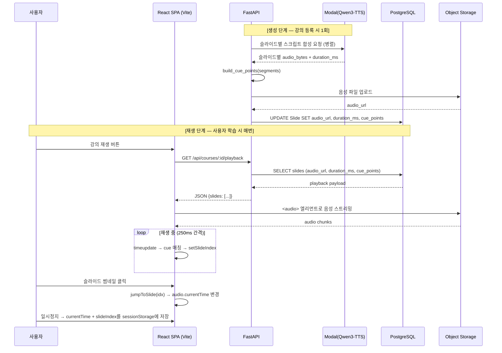

# 음성-슬라이드 싱크 설계 가이드

> AI 과외 플랫폼 — Qwen3-TTS (Modal GPU) TTS 음성과 자동 생성 슬라이드의 동기 재생 설계 문서
> 대상 스택: FastAPI(Python) + React + TS + Tailwind + shadcn/ui + Motion (Vite SPA, React Router v6) + PostgreSQL + Qwen3-TTS (Modal GPU)

---

## 섹션 1. 결론 (TL;DR)

음성-슬라이드 싱크는 **DB와 런타임 로직 양쪽 모두 사용해야 한다**. 정적이고 콘텐츠에 종속된 정보(어느 시점에 몇 번째 슬라이드로 넘어가는지)는 DB에 저장하고, 일시적이고 사용자 세션에 종속된 정보(현재 재생 위치, 일시정지 상태)는 클라이언트 런타임 상태로만 다룬다. 둘을 섞으면 동시 접속, 일시정지/되감기, 페이지 새로고침, 탭 전환 같은 시나리오에서 반드시 깨진다.

세 가지 가능한 전략 중 본 프로젝트에는 **전략 B (Cue Point 방식)** 을 권장한다.

| 전략 | 핵심 아이디어 | 장점 | 단점 |
|---|---|---|---|
| **A. 슬라이드 단위 재생** | 슬라이드마다 음성 파일을 1개씩 만들고 끝나면 다음 슬라이드 자동 로드 | 구현 단순, ERD 변경 최소 | 슬라이드 사이 간격에서 미세한 침묵·끊김 발생, 사용자 슬라이드 점프 시 음성 재로딩 비용 |
| **B. Cue Point 방식 (권장)** | 슬라이드별 음성을 concat한 단일 트랙 + 슬라이드 전환 타임스탬프(cue_points)를 DB에 저장 | 끊김 없는 자연스러운 재생, 점프/되감기 즉시 반응, 학습 통계 집계 용이 | TTS 생성 파이프라인에 timestamp 계산 단계 추가 필요 |
| **C. 클라이언트 완전 처리** | DB는 음성 URL만 들고, 전환 시점은 프론트가 길이 측정해서 추정 | 백엔드 로직 가벼움 | 매 재생마다 클라이언트 측정 → 첫 재생 지연, 디바이스별 재생률 차이로 싱크 어긋남, 멀티 사용자 분석 불가 |

전략 B는 "정적 메타데이터는 한 번 계산해서 DB에 박아두고 모든 클라이언트는 그것을 신뢰만 한다"는 원칙에 가장 부합한다. 한 번 만든 강의는 모든 학습자에게 똑같이 재생되어야 하고, 분석을 위해서도 "이 슬라이드는 7.8초 시점에 시작한다"는 사실이 서버 측에 정답으로 존재해야 한다.

---

## 섹션 2. "DB vs 런타임 로직" 판단 기준

데이터의 수명과 소유자를 기준으로 명확히 분리한다.

| 분류 | 데이터 예시 | 저장 위치 | 이유 |
|---|---|---|---|
| **DB 영속 (정적)** | 음성 URL, audio_duration_ms, cue_points, 슬라이드 인덱스, 스크립트 텍스트 | PostgreSQL `slide` / 관련 테이블 | 콘텐츠와 1:1 종속, 모든 사용자에게 동일, 한 번 생성하면 변하지 않음 |
| **런타임 (일시)** | 현재 재생 위치(currentTime), 재생/일시정지 플래그, 버퍼 상태, 볼륨, 배속 | 브라우저 메모리(React state) + sessionStorage | 사용자·세션·디바이스마다 다름, 영속화 가치 낮음, 새로고침 시 복원 정도면 충분 |
| **이벤트 집계 (분석)** | 슬라이드별 체류 시간, 일시정지 횟수, 되감기 횟수, 완강 여부 | 별도 테이블 `playback_event` | 학습 통계·리포트 용도, 실시간 재생 상태와는 독립, 비동기 적재 가능 |

핵심 규칙: **DB는 "콘텐츠가 어떻게 생겼는가"를 책임지고, 런타임은 "지금 이 사용자가 어디까지 들었는가"를 책임진다.** 두 경계를 흐리면 동시성·동기화 비용이 폭증한다. 학습 통계는 제3의 영역으로 떼어서 이벤트 스트림으로 다룬다.

---

## 섹션 3. ERD 확장 제안 (실제 선택)

### 옵션 A (추천) — Slide 테이블에 필드 추가

```sql
ALTER TABLE slide
  ADD COLUMN audio_url           VARCHAR(500),
  ADD COLUMN audio_duration_ms   INTEGER,
  ADD COLUMN cue_points          JSONB;

-- cue_points 예시
-- [
--   {"offset_ms": 0,     "type": "slide_start"},
--   {"offset_ms": 3200,  "type": "emphasis", "target": "bullet_2"},
--   {"offset_ms": 7800,  "type": "slide_end"}
-- ]
```

`cue_points`는 슬라이드 내부의 강조·전환 타이밍을 모두 담는 JSONB 배열이다. 슬라이드 단위로 음성을 끊지 않고 전체 강의를 단일 트랙으로 다룰 경우, `course` 또는 `lecture` 테이블에 글로벌 cue_points를 두는 변형도 가능하다. 본 가이드는 슬라이드 단위로 저장하되 재생 시 concat한다고 가정한다.

### 옵션 B — 별도 SlideAudioCue 테이블

```sql
CREATE TABLE slide_audio_cue (
  id          BIGSERIAL PRIMARY KEY,
  slide_id    BIGINT NOT NULL REFERENCES slide(id) ON DELETE CASCADE,
  offset_ms   INTEGER NOT NULL,
  cue_type    VARCHAR(32) NOT NULL,  -- 'slide_start' | 'emphasis' | 'slide_end'
  payload     JSONB,
  created_at  TIMESTAMPTZ NOT NULL DEFAULT NOW()
);

CREATE INDEX idx_slide_audio_cue_slide ON slide_audio_cue(slide_id, offset_ms);
```

### 두 옵션 비교

| 항목 | 옵션 A (JSONB 필드) | 옵션 B (별도 테이블) |
|---|---|---|
| 조회 성능 | 슬라이드 한 번 SELECT로 모든 cue 획득 (가장 빠름) | JOIN 1회 추가 필요 |
| 수정 비용 | JSON 통째 교체 | 행 단위 INSERT/UPDATE 가능 |
| 쿼리 유연성 | JSON path 연산자 필요 | 일반 SQL로 cue_type별 집계 가능 |
| 분석 용이성 | cue 단독 분석 시 jsonb_array_elements 필요 | GROUP BY cue_type 즉시 가능 |
| 스키마 진화 | JSON 구조만 합의하면 됨 | 마이그레이션 필요 |
| 개수 적합성 | 슬라이드당 5~20개 cue에 적합 | 슬라이드당 100+ cue 시 유리 |

**옵션 A를 추천한다.** 본 프로젝트의 cue는 슬라이드당 평균 5~10개 수준(시작·종료 + 강조 몇 개)이고, 재생 시점에 항상 슬라이드와 함께 조회되므로 JSONB 필드가 가장 단순하고 빠르다. 분석은 어차피 별도 `playback_event` 테이블에서 다루기 때문에 cue를 SQL로 조각낼 일이 적다. 추후 cue 종류가 폭발적으로 늘어나면 옵션 B로 마이그레이션하는 것은 어렵지 않다(JSONB → 행 변환 스크립트 1회).

---

## 섹션 4. 생성 파이프라인 (백엔드)

강의안이 만들어진 직후 비동기 워커가 슬라이드별 TTS를 생성하고 cue_points를 계산해서 DB에 적재한다.

```python
# backend/services/audio_pipeline.py
from dataclasses import dataclass
from typing import List, Dict, Any
import asyncio
from modal_qwen3_tts import ModalQwen3TTSClient
from storage import upload_to_object_storage
from db import slide, get_session

@dataclass
class TTSSegment:
    """슬라이드 1장에 해당하는 TTS 결과."""
    slide_index: int
    audio_bytes: bytes
    duration_ms: int

async def generate_slide_audio(slide_scripts: List[str]) -> List[TTSSegment]:
    """슬라이드별 스크립트를 받아 TTS 세그먼트 리스트를 반환한다."""
    tts = ModalQwen3TTSClient()
    # 슬라이드별로 병렬 합성 (TTS 서버 부하 고려해 동시성 제한)
    sem = asyncio.Semaphore(4)

    async def _one(idx: int, script: str) -> TTSSegment:
        async with sem:
            result = await tts.synthesize(text=script, voice="ko-tutor-female")
            return TTSSegment(
                slide_index=idx,
                audio_bytes=result.audio,
                duration_ms=result.duration_ms,
            )

    return await asyncio.gather(*[_one(i, s) for i, s in enumerate(slide_scripts)])

def build_cue_points(segments: List[TTSSegment]) -> List[Dict[str, Any]]:
    """슬라이드 경계를 cue_points JSON으로 변환한다."""
    cues = []
    offset = 0
    for seg in segments:
        cues.append({
            "offset_ms": offset,
            "type": "slide_start",
            "slide_index": seg.slide_index,
        })
        offset += seg.duration_ms
        cues.append({
            "offset_ms": offset,
            "type": "slide_end",
            "slide_index": seg.slide_index,
        })
    cues.append({"offset_ms": offset, "type": "complete"})
    return cues

async def materialize_audio(course_id: int, slide_scripts: List[str]) -> None:
    """생성→업로드→DB 저장까지의 전체 파이프라인."""
    segments = await generate_slide_audio(slide_scripts)
    cues = build_cue_points(segments)

    # 슬라이드별로 분리 저장하는 경우 (옵션 A 변형)
    async with get_session() as session:
        for seg in segments:
            url = await upload_to_object_storage(
                key=f"courses/{course_id}/slide_{seg.slide_index}.mp3",
                data=seg.audio_bytes,
            )
            slide = await session.get_slide(course_id, seg.slide_index)
            slide.audio_url = url
            slide.audio_duration_ms = seg.duration_ms
            # 슬라이드 내부 강조 cue가 있으면 여기서 합쳐줌
            slide.cue_points = [
                c for c in cues
                if c.get("slide_index") == seg.slide_index
            ]
        await session.commit()
```

핵심 포인트:
- TTS 호출은 슬라이드별로 병렬화하되 동시성 제한(`Semaphore`)으로 GPU 서버 부하를 통제한다.
- duration_ms는 Qwen3-TTS (Modal GPU)가 직접 반환하는 값을 신뢰한다. 후처리(libsndfile, ffprobe)로 재측정해도 되지만 비용 대비 정확도 차이가 작다.
- cue_points는 슬라이드 단위로 분리 저장 시 각 슬라이드의 로컬 offset(0부터 시작)과 글로벌 offset(강의 전체 기준) 중 **로컬 offset을 권장한다**. 글로벌 offset은 슬라이드 추가/삭제 시 모두 다시 계산해야 해서 유지보수가 어렵다.

---

## 섹션 5. 재생 파이프라인 (프론트엔드)

React SPA(Vite + React Router) 학습 페이지에서 단일 `<audio>` 엘리먼트로 슬라이드별 음성을 순차 재생하고, `timeupdate` 이벤트로 현재 슬라이드를 갱신한다.

```typescript
// frontend/hooks/usePlaybackSync.ts
import { useEffect, useRef, useState } from 'react';

export type CuePoint = {
  offset_ms: number;
  type: 'slide_start' | 'slide_end' | 'emphasis' | 'complete';
  slide_index?: number;
  target?: string;
};

export type SlideAudio = {
  slide_index: number;
  audio_url: string;
  audio_duration_ms: number;
  cue_points: CuePoint[];
};

/**
 * 단일 audio 엘리먼트로 슬라이드 음성을 순차 재생하면서
 * 현재 재생 중인 슬라이드 인덱스를 반환한다.
 */
export function usePlaybackSync(slides: SlideAudio[]) {
  const audioRef = useRef<HTMLAudioElement | null>(null);
  const [slideIndex, setSlideIndex] = useState(0);

  // 슬라이드 시작 누적 offset 테이블 (글로벌 타임라인)
  const startOffsets = slides.reduce<number[]>((acc, s, i) => {
    acc.push(i === 0 ? 0 : acc[i - 1] + slides[i - 1].audio_duration_ms);
    return acc;
  }, []);

  useEffect(() => {
    const el = audioRef.current;
    if (!el) return;

    const onTick = () => {
      const tMs = el.currentTime * 1000;
      // 현재 시점이 속한 슬라이드 찾기 (선형 탐색이지만 N≤200 수준이라 충분)
      const next = startOffsets.findLastIndex((off) => off <= tMs);
      if (next >= 0 && next !== slideIndex) {
        setSlideIndex(next);
      }
    };

    el.addEventListener('timeupdate', onTick);
    return () => el.removeEventListener('timeupdate', onTick);
  }, [slides, slideIndex, startOffsets]);

  /**
   * 사용자가 슬라이드 썸네일을 클릭했을 때 음성도 동기 점프.
   */
  const jumpToSlide = (idx: number) => {
    const el = audioRef.current;
    if (!el || !startOffsets[idx]) return;
    el.currentTime = startOffsets[idx] / 1000;
    setSlideIndex(idx);
  };

  return { audioRef, slideIndex, jumpToSlide };
}
```

```tsx
// frontend/components/CoursePlayer.tsx
import { usePlaybackSync } from '@/hooks/usePlaybackSync';

export function CoursePlayer({ slides }: { slides: SlideAudio[] }) {
  const { audioRef, slideIndex, jumpToSlide } = usePlaybackSync(slides);

  // 슬라이드 음성 파일이 분리 저장된 경우, MediaSource API로 concat하거나
  // 서버 측에서 합본을 미리 만들어 단일 URL로 제공하는 방법이 더 안정적이다.
  const combinedAudioUrl = `/api/courses/${slides[0].slide_index}/audio_combined.mp3`;

  return (
    <div className="player">
      <SlideView slide={slides[slideIndex]} />
      <SlideThumbnails
        slides={slides}
        active={slideIndex}
        onClick={jumpToSlide}
      />
      <audio
        ref={audioRef}
        src={combinedAudioUrl}
        controls
        preload="metadata"
      />
    </div>
  );
}
```

핵심 포인트:
- 슬라이드별 mp3를 클라이언트에서 순차 로딩하면 전환마다 끊김이 생긴다. **합본 mp3를 서버에서 미리 만들어두는 것이 가장 안정적이다.** 합본을 만들지 않으려면 MediaSource Extensions(MSE)로 segment append 방식을 써야 하는데 브라우저 간 구현 차이 검증 비용이 크다.
- `findLastIndex`는 ES2023 메서드다. Vite + React(최신 브라우저 타겟) 환경에서는 폴리필 없이 동작하나, 구형 브라우저 지원이 필요하면 `for` 역방향 루프로 대체한다.
- `timeupdate`는 250ms 간격으로 발화되므로 슬라이드 전환 정밀도는 ±250ms이다. 더 정밀해야 한다면 `requestVideoFrameCallback` 대신 `requestAnimationFrame` + `audio.currentTime` 폴링으로 60fps 갱신 가능하지만, 학습 콘텐츠에는 과한 정밀도다.

---

## 섹션 6. 시퀀스 다이어그램



---

## 섹션 7. 엣지 케이스

| 케이스 | 대응 방법 |
|---|---|
| **TTS 음성 다운로드 실패** | `<audio>`의 `error` 이벤트 핸들러에서 CDN 폴백 URL로 재시도. `preload="metadata"`로 첫 메타데이터 로드 단계에서 빠르게 실패 감지. 3회 실패 시 사용자에게 에러 토스트. |
| **브라우저 자동재생 정책** | Chrome은 MEI(Media Engagement Index) 기반 Autoplay Policy를 적용한다. 첫 방문 사용자는 MEI가 낮아 자동재생이 차단된다. TTS 음성 강의가 핵심 기능이므로 첫 재생 실패는 치명적이다. **구현 패턴**: "첫 슬라이드 진입 → ▶ 강의 시작 버튼 클릭 → AudioContext 활성화 → 이후 슬라이드는 자동 재생 가능". 한 번 클릭하면 그 세션 동안 자동재생이 풀린다. UX 손실은 버튼 클릭 1회뿐이며 안정성은 100%다. 이 가드를 제거하면 "왜 소리가 안 나요?" 문의가 발생한다. Firefox·Safari도 동일하게 적용한다. |
| **네트워크 끊김** | 일정 간격(예: 5초)으로 `{slideIndex, currentTime, slideId}`를 sessionStorage에 저장. 페이지 복귀 시 복원 다이얼로그("이어서 재생할까요?") 표시. 온라인 복귀 시 미적재 playback_event를 일괄 업로드한다. |
| **사용자 수동 슬라이드 클릭** | `jumpToSlide`로 audio.currentTime을 cue offset으로 점프. seek 이벤트 발생 → timeupdate가 새 시점으로 갱신되므로 자동으로 슬라이드 인덱스도 따라옴. |
| **오프라인 학습** | (선택 기능) Service Worker로 audio + slide 이미지·텍스트를 사전 캐시. IndexedDB에 cue_points 함께 보관. 온라인 복귀 시 PlaybackEvent를 일괄 업로드. |
| **배속 재생 (0.75x ~ 2x)** | `audio.playbackRate` 조정만으로 충분. cue 매칭은 currentTime 기반이라 자동으로 빨라지거나 느려진다. 단, TTS 특성상 1.5x 이상에서 음질 열화가 있으니 UI에서 0.75/1.0/1.25/1.5 정도만 노출 권장. |
| **장시간 일시정지 후 복귀** | 브라우저가 audio 디코더를 해제했을 가능성 있음. 복귀 시 `audio.load()`를 한 번 호출하고 currentTime을 다시 세팅한 뒤 play. |
| **슬라이드 간 미세한 침묵** | 서버에서 합본 mp3를 만들 때 슬라이드 사이에 0.3초 무음 패딩을 넣으면 청취 경험이 자연스러움. cue_points의 offset도 그만큼 보정해서 저장. |
| **동시 다중 탭 재생** | sessionStorage는 탭별 격리되어 있어 충돌 없음. localStorage 쓰지 말 것. |
| **강의 콘텐츠 수정 후 재생성** | cue_points와 audio_url 모두 갱신. 클라이언트는 `ETag` 또는 `audio_version` 필드로 캐시 무효화. |

---

## 섹션 8. 학습 통계 연동 (참고)

재생 중 발생하는 이벤트는 실시간 재생 상태와 분리해서 별도 테이블에 적재한다. 학습 리포트·완강률·집중도 분석의 원천이 된다.

```sql
CREATE TABLE playback_event (
  id         VARCHAR(36) PRIMARY KEY DEFAULT gen_random_uuid()::text,
  user_id    VARCHAR(36) NOT NULL,
  slide_id   VARCHAR(36) NOT NULL,
  event_type VARCHAR(20) NOT NULL
    CHECK (event_type IN ('play','pause','seek','complete')),
  offset_ms  INTEGER NOT NULL,
  payload    JSONB,
  created_at TIMESTAMPTZ NOT NULL DEFAULT NOW(),
  FOREIGN KEY (user_id)  REFERENCES "user"(id)  ON DELETE CASCADE,
  FOREIGN KEY (slide_id) REFERENCES slide(id)   ON DELETE CASCADE
);
CREATE INDEX idx_playback_event_user  ON playback_event(user_id, created_at DESC);
CREATE INDEX idx_playback_event_slide ON playback_event(slide_id, event_type);
```

프론트는 5초 주기 batch로 이벤트를 모아 `POST /api/playback/events`에 전송. 백엔드는 큐(Redis Stream 또는 Kafka)로 받아 비동기 적재. 학습 리포트는 이 테이블을 집계해서 만들고, 재생 자체의 동기화에는 절대 의존하지 않는다.

### payload 컬럼 예시

| payload 예시 | 해석 |
|---|---|
| `{"direction":"back"}` | 되감기 seek |
| `{"direction":"forward"}` | 앞으로 seek |
| `{"volume":0.8}` | 볼륨 변경 |
| `{"speed":1.25}` | 배속 변경 |
| `{"qa_id":"..."}` | 질답 중 일시정지 컨텍스트 |

되감기 집계 쿼리:
```sql
SELECT COUNT(*) FROM playback_event
WHERE event_type = 'seek' AND payload->>'direction' = 'back';
```

---

## 섹션 9. 구현 체크리스트

- [ ] **DB 마이그레이션**: `slide` 테이블에 `audio_url VARCHAR(500)`, `audio_duration_ms INTEGER`, `cue_points JSONB` 추가
- [ ] **DB 마이그레이션**: `playback_event` 테이블 신규 생성 + 인덱스
- [ ] **TTS 생성 잡**: Qwen3-TTS (Modal GPU) 호출 + duration_ms 수집 + cue_points 계산 + 오브젝트 스토리지 업로드
- [ ] **합본 mp3 생성**: ffmpeg로 슬라이드 음성 concat + 0.3초 무음 패딩 삽입
- [ ] **백엔드 엔드포인트**: `GET /api/courses/:id/playback` — 슬라이드 + cue_points 반환
- [ ] **백엔드 엔드포인트**: `POST /api/playback/events` — 이벤트 batch 수신
- [ ] **프론트 훅**: `usePlaybackSync` — timeupdate 기반 슬라이드 인덱스 동기화
- [ ] **프론트 컴포넌트**: `CoursePlayer` — `<audio>` + 슬라이드 뷰 + 썸네일 네비
- [ ] **점프 UI**: 슬라이드 썸네일 클릭 → `jumpToSlide` 연결
- [ ] **브라우저 자동재생 가드 (핵심 요구사항)**: 첫 슬라이드 진입 시 "▶ 강의 시작" 버튼 표시 → 클릭 시 `AudioContext` 활성화 → 이후 슬라이드 전환은 자동 재생. Chrome MEI 정책·Firefox·Safari 공통 대응. 세션 내 버튼 클릭 1회만 필요하며 이후는 자동재생 유지.
- [ ] **▶ 강의 시작 버튼 컴포넌트**: 첫 슬라이드 진입 감지 + `AudioContext` 첫 활성화 로직. 한 번 활성화되면 버튼은 사라지고 자동재생 모드로 전환.
- [ ] **세션 복원**: sessionStorage 5초 주기 저장 + 페이지 복귀 시 다이얼로그
- [ ] **오류 처리**: audio error 이벤트 핸들러 + CDN 폴백 + 사용자 토스트
- [ ] **배속 컨트롤**: 0.75 / 1.0 / 1.25 / 1.5 토글 UI
- [ ] **PlaybackEvent 적재 연결**: play/pause/seek/complete 이벤트 + payload 필드 포함
- [ ] **테스트**: 슬라이드 점프, 일시정지/재개, 새로고침 복원, 데스크톱 Chrome/Firefox/Safari E2E

---

## 부록. 관련 의사결정 요약

| 결정 | 선택 | 이유 |
|---|---|---|
| 싱크 정보 저장 위치 | DB(영속) + 런타임(일시) 분리 | 콘텐츠 정보와 사용자 세션 정보는 수명·소유자가 다르다 |
| 전략 | B (Cue Point) | 끊김 없는 재생 + 점프/되감기 즉시성 + 분석 용이성 |
| ERD | 옵션 A (Slide JSONB 필드) | 슬라이드와 항상 동시 조회, cue 개수가 작음 |
| 음성 파일 형태 | 서버 합본 mp3 | 클라이언트 concat은 브라우저 간 구현 차이 검증 비용이 큼 |
| cue offset 기준 | 슬라이드 로컬 offset | 슬라이드 추가/삭제 시 글로벌 offset 재계산 회피 |
| 정밀도 | ±250ms (timeupdate 기반) | 학습 콘텐츠에 충분, 더 정밀하면 배터리·CPU 비용 증가 |
| 학습 통계 | PlaybackEvent 별도 테이블 | 재생 동기화와 분석을 동일 경로에 묶지 않음 |

---
